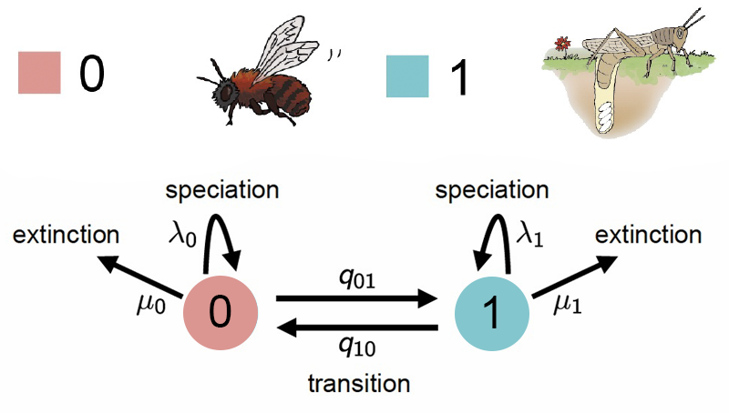

# Presentación: Introducción a Binary State Speciation and Extinction (BISSE)

[{fig-align="center" width="500"}](../docs/u1_PatDiv/BiSSE.pdf)

Haz clic en la imagen para ver el PDF de la presentación

Analizaremos si las tasas de diversificación están asociadas al tipo de hospedero en los escarabajos meloidos (Meloidae). Las subfamilias Nemognathinae y Meloinae presentan un ciclo de vida complejo, caracterizado por múltiples metamorfosis y estrategias de parasitoidismo. La mayoría de los géneros y tribus dentro de estas subfamilias son parasitoides de abejas, incluyendo especies foréticas y no foréticas. Sin embargo, dos tribus han adoptado una estrategia distinta, alimentándose de huevos de saltamontes. Estas diferencias en las estrategias de vida están asociadas con marcadas variaciones en la riqueza de especies entre clados ([López-Estrada et al., 2019](https://onlinelibrary.wiley.com/doi/full/10.1111/mec.16390)).

# Modelo BiSSE (Binary state speciation and extinction, [Madisson et al. 2007](https://academic.oup.com/sysbio/article/56/5/701/1694265))

BiSSE el modelo de especiación y extinción dependendiente de un caracter binario y es un proceso estocástico que se forma de la composición de dos procesos de nacimiento y muerte. Los dos procesos se conectan a través de dos tasas de cambio conocidas como las tasas de transición. El supuesto más importante del modelo BiSSE es que cada estado tiene su propia tasa de especiación $\lambda$ y su propia tasa de extinción $\mu$ que representan el momento en el cuál un linaje se divide en dos o se extingue. Este es un supuesto muy importante porque la implicación es que la acumulación (o la falta de acumulación) de linajes es el resultado del valor del estado. Pueden encontrar mas información en el material del taller [Filo-Bayes](https://ixchelgzlzr.github.io/filo_bayes_UNAM/) - [BISSE](https://ixchelgzlzr.github.io/filo_bayes_UNAM/docs/discrete/SSEmodels.html).

**Escarabajos meloidos**

{fig-align="center" width="550"}

Las transiciones entre estados ocurren a tasas $q_{01}$ (de abeja a saltamontes) y $q_{10}$ (de saltamontes a abeja). Cada estado tiene su propia tasa de especiación ($\lambda_0, \lambda_1$) y extinción ($\mu_0, \mu_1$).

**Matriz de tasas de transición (**$Q$)

La matriz de transición $Q$ define la probabilidad de cambio entre estados en un tiempo infinitesimal:

$$
Q =
\begin{bmatrix}
  -q_{01} & q_{01} \\
  q_{10} & -q_{10}
\end{bmatrix}
$$

Donde:

-   $q_{01}$: es la tasa de transición de hospedero abeja a hospedero saltamontes.

-   $q_{10}$: es la tasa de transición de hospedero saltamontes a hospedero abeja.

-   La diagonal contiene los valores negativos de las tasas de salida de cada estado ($-q_{01}$ y $-q_{10}$), de modo que cada fila suma cero.

**Parámetros en el modelo BiSSE**

El modelo incluye seis parámetros fundamentales:

-   $\lambda_0$: tasa de especiación en el estado 0 (hospedero abeja)

-   $\lambda_1$: tasa de especiación en el estado 1 (hospedero saltamontes)

-   $\mu_0$: tasa de extinción en el estado 0

-   $\mu_1$: tasa de extinción en el estado 1

-   $q_{01}$: tasa de cambio de hospedero abeja a hospedero saltamontes

-   $q_{10}$: tasa de cambio de hospedero saltamontes a hospedero abeja

**Simulación bajo el modelo BiSSE**

El siguiente script simula un proceso de diversificación bajo el modelo **BiSSE (Binary State Speciation and Extinction)**, considerando dos estados observados (`0` y `1`) con tasas independientes de especiación, extinción y transición.

📥 Puedes descargar el script en el siguiente enlace:

<a href="../docs/u1_PatDiv/Simulacion_BiSSE.R" download>📥 Descargar script de simulación BiSSE</a>

## Descarga del Árbol Filogenético y la matriz codificada

📥 Puedes descargar el archivo **.tre** con el árbol en el siguiente enlace:

<a href="../docs/u1_PatDiv/ConLyttini.tre" download>📥 Descargar Árbol Filogenético</a>

📥 Puedes descargar el archivo **.nex** con la matriz codificada en el siguiente enlace:

<a href="../docs/u1_PatDiv/Traits_conLyttini_01.nex" download>📥 Descargar Matriz Codificada</a>

Guarda los archivos en la carpeta correspondiente y verifica su ubicación antes de continuar.

## Carga de la filogenia y los datos

Crea un script `.Rev` y copia el codigo de la siguiente sección:

``` r
# Leer el arbol
T <- readTrees("../data/ConLyttini.tre")[1]

# Leer la matriz de caracteres
datos <- readCharacterData("../data/Traits_conLyttini_01.nex")
```

## Definir el número de estados en los modelos BISSE

``` r
NUM_STATES = 2
```

## Definir vectores para almacenar los movimientos de MCMC y los monitores de resultados.

``` r
moves    = VectorMoves()
monitors = VectorMonitors()
```

## Valores de la log-normal

De acuerdo con Nee et al. (1994) el número esperado de linajes en la corona de un clado con `n` taxones bajo un proceso de nacimiento y muerte en el tiempo `t` es:

$(\lambda - \mu) = \frac{In(n)/2}{t}$

En donde: `n` = es el número de especies y `t` = es la edad de la filogenia

``` r
# Definimos una a priori log normal
rate_mean <- ln(ln(3000.0/2.0) / T.rootAge())

# Con una varianza que es amplia
rate_sd <- 0.587405

for (i in 1:NUM_STATES) {
# lognormales de las especiaciones
  log_speciation[i] ~ dnNormal(mean=rate_mean, sd=rate_sd) 
  speciation[i] := exp(log_speciation[i])
  moves.append(mvSlide(log_speciation[i], delta=0.20, tune=true, weight=3.0))

# lognormales de las extinciones
  log_extinction[i] ~ dnNormal(mean=rate_mean, sd=rate_sd)  
  extinction[i] := exp(log_extinction[i])
  moves.append(mvSlide(log_extinction[i], delta=0.20, tune=true, weight=3.0))
}
```

## Definir la **matriz de tasas de transición** entre los estados del carácter

``` r
# Calcula la suma de todas las longitudes de las ramas del árbol filogenético
# Dividido por 10: Esto asume que en promedio ocurren 10 cambios de estado a lo largo del árbol
rate_pr := T.treeLength() / 10
```

## Definición de las tasas de transición

``` r
# Tasa de transición de estado 1 → estado 2 
rate_12 ~ dnExp(rate_pr)

# Tasa de transición de estado 2 → estado 1 
rate_21 ~ dnExp(rate_pr)

# Definición de movimientos 
moves.append(mvScale(rate_12, weight=2))
moves.append(mvScale(rate_21, weight=2))
```

**¿Por qué usar una exponencial?**

-   La distribución exponencial es adecuada para modelar **tasas de transición** porque impone la condición de que siempre sean **positivas**.

-   También asigna **mayor probabilidad a valores pequeños**, lo que significa que los cambios de estado no ocurren demasiado rápido.

## Creación de la matriz de tasas de transición

``` r
rate_matrix := fnFreeBinary([rate_12, rate_21 ], rescaled=false)
```

## Frecuencias del estado en la raíz

``` r
rate_category_prior ~ dnDirichlet(rep(1,NUM_STATES))
moves.append(mvDirichletSimplex(rate_category_prior, tune=true, weight=2))
```

## Fijar la edad de la raíz

``` r
root <- T.rootAge()
```

## Definir $\rho$ : Proporción de especies muestreadas

``` r
rho <- T.ntips()/3000
```

## Construcción del árbol evolutivo generado a partir de un proceso de nacimiento y muerte dependiente del carácter

``` r
timetree ~ dnCDBDP(rootAge = root, speciationRates = speciation, extinctionRates = extinction, Q = rate_matrix, pi = rate_category_prior, delta = 1.0, rho = rho, condition = "time")
```

🔹 **Parámetros del proceso de nacimiento y muerte (`dnCDBDP`)**:

-   **`rootAge = root`** → Se fija la edad de la raíz usando `root = T.rootAge()`.

-   **`speciationRates = speciation`** → Se usa la tasa de especiación (`λ`).

-   **`extinctionRates = extinction`** → Se usa la tasa de extinción (`μ`).

-   **`Q = rate_matrix`** → Usa la **matriz de tasas de transición** de caracteres (`rate_12`, `rate_21`).

-   **`pi = rate_category_prior`** → Usa la distribución **a priori** de los estados en la raíz.

-   **`delta = 1.0`** → Parámetro de ajuste para la distribución de tiempos de especiación/extinción.

-   **`rho = rho`** → Probabilidad de muestreo de especies (`rho = T.ntips()/3000`).

-   **`condition = "time"`** → Condiciona el proceso a un tiempo de raíz fijo.

## Fijar (`clamp`) los datos observados

``` r
timetree.clamp(T)
timetree.clampCharData(datos)
```

## Creación del modelo

``` r
### workspace model wrapper ###
mymodel = model(rate_matrix)
```

## Configuración de los monitores

Los **monitores** guardan los resultados en archivos o los imprimen en pantalla.

``` r
monitors.append(mnModel(filename="../out/Bisse/mitos_BiSSE_clyttini.log", printgen=1))
monitors.append(mnJointConditionalAncestralState(tree=timetree, cdbdp=timetree, type="Standard", printgen=1, withTips=true, withStartStates=false, filename="../out/Bisse/anc_states_MITOS_BiSSE_clyttini.log"))
monitors.append(mnStochasticCharacterMap(cdbdp=timetree, printgen=10, filename="../out/Bisse/SCHM_BiSSE_clyttini.log"))
monitors.append(mnScreen(printgen=10, rate_12, rate_21, speciation, extinction))
```

## **Inicializar y Ejecutar el MCMC**

Con el modelo y los monitores listos, creamos el **objeto MCMC** e iniciamos la simulación.

``` r
mymcmc = mcmc(mymodel, monitors, moves, nruns=1, moveschedule="random")
```

-   `mymodel`: hace referencia al modelo que estás analizando.

-   `monitors`: son las variables que se registrarán en el archivo de salida.

-   `moves`: operadores MCMC que proponen cambios en los parámetros del modelo.

-   `nruns=1`: solo una cadena MCMC (puedes usar más si deseas una inferencia más robusta).

-   `moveschedule="random"`: ejecuta los operadores en orden aleatorio para evitar sesgos en la exploración del espacio de parámetros.

## Ejecutar el MCMC

``` r
mymcmc.run(generations=400)
```

## Generar un árbol anotado con los estados ancestrales (MAP)

``` r
anc_states = readAncestralStateTrace("../out/Bisse/anc_states_MITOS_BiSSE_clyttini.log")

anc_tree = ancestralStateTree(tree=T, ancestral_state_trace_vector=anc_states, include_start_states=false, file="../out/Bisse/mitos_bisse_anc_states_results.tree", burnin=0.2, summary_statistic="MAP", site=1)
```

## Generar un mapeo estocástico de caracteres (Stochastic Character Mapping)

``` r
anc_state_trace = readAncestralStateTrace("../out/Bisse/SCHM_BiSSE_clyttini.log")

characterMapTree(tree=T, ancestral_state_trace_vector=anc_state_trace, character_file="../out/Bisse/mitos_bisse_stoch_map_character.tree", posterior_file="../out/Bisse/mitos_bisse_stoch_map_posterior.tree", burnin=0.2, reconstruction="marginal")
```

## Visualización en R con RevGadgets

```{r, , results='hide'}
library(tidyverse)
library(RevGadgets)
library(ggtree)

# Cargar el archivo de estados ancestrales
bisse_file <- paste0("../docs/u1_PatDiv/output/bisse/mitos_bisse_anc_states_results.tree")
p_anc <- processAncStates(bisse_file)

# Definir paleta de colores personalizada
traitcols <- c("#F29494", "#5FD9D9")  

# Generar el gráfico con estados 
plot <- plotAncStatesMAP(p_anc,
        tree_layout = "rect",
        tip_labels_size = 1) +
        # Aplicar la paleta de colores
        scale_color_manual(values = traitcols) +
        scale_fill_manual(values = traitcols) +
        # Modificar leyenda y otros elementos de ggplot2
        theme(legend.position = c(0.1, 0.85),
              legend.key.size = unit(0.3, 'cm'), # Tamaño de la clave de la leyenda
              legend.title = element_text(size = 6), # Tamaño del título de la leyenda
              legend.text = element_text(size = 4))  # Tamaño del texto de la leyenda

# Mostrar el gráfico
plot

# Generar el gráfico con ramas coloreadas por estado ancestral
plot_2 <- ggtree(p_anc, layout = "rectangular", aes(color = anc_state_1)) +
  scale_color_manual(name = "Estado", values = traitcols) +  
  theme_minimal() +
  ggtitle("BISSE") +
  theme(legend.position = c(0.1, 0.85),
        legend.key.size = unit(0.3, 'cm'), # Tamaño de la clave de la leyenda
        legend.title = element_text(size = 6), # Tamaño del título de la leyenda
        legend.text = element_text(size = 4))  # Tamaño del texto de la leyenda

# Mostrar el gráfico
plot_2

```

## Graficar las tasas de transición

```{r}
library(tidyverse)

# Leer el archivo de salida de RevBayes
bisse <- read.table("../docs/u1_PatDiv/output/bisse/mitos_BiSSE_clyttini.log", header = TRUE)

# Definir colores para los estados 0 y 1
traitcols <- c("#F29494", "#5FD9D9")  

# Crear un dataframe con solo las tasas de transición
transition_rates <- data.frame(
  dens = c(bisse$rate_12, bisse$rate_21), 
  rate = rep(c("0", "1"), each = length(bisse$rate_12))
)

# Crear un gráfico de violín para las tasas de transición
violin_transitions <- ggplot(transition_rates, aes(x = rate, y = dens, fill = rate)) +
  geom_violin(trim = FALSE) +
  labs(title = "Tasas de Transición", x = "Estado", y = "Tasa") +
  scale_fill_manual(name = "Estado", values = traitcols) +
  theme_classic()

# Mostrar la gráfica
violin_transitions
```

## Graficar las tasas de diversificación neta

```{r}
# Calcular la tasa de diversificación neta: especiación - extinción
netdiversification_rates <- data.frame(
  dens = c(bisse$speciation.1. - bisse$extinction.1.,
           bisse$speciation.2. - bisse$extinction.2.),
  rate = rep(c("0", "1"), each = length(bisse$speciation.1.))
)

# Convertir la variable de estado en factor
netdiversification_rates$rate <- factor(netdiversification_rates$rate, levels = c("0", "1"))

# Crear el gráfico de violín para tasas de diversificación neta
violin_diversification <- ggplot(netdiversification_rates, aes(x = rate, y = dens, fill = rate)) +
  geom_violin(trim = FALSE) +
  labs(title = "Tasas de Diversificación Neta", x = "Estado", y = "Tasa") +
  scale_fill_manual(name = "Estado", values = traitcols) +
  theme_classic()

# Mostrar la gráfica
violin_diversification
```

## Graficar tasas de especiación

```{r}
# Crear un dataframe con tasas de especiación para cada estado
speciation_rates <- data.frame(
  dens = c(bisse$speciation.1.,  bisse$speciation.2.), 
  rate = rep(c("0", "1"), each = length(bisse$speciation.1.))
)

# Crear gráfico de violín para las tasas de especiación
violin_speciation <- ggplot(speciation_rates, aes(x = rate, y = dens, fill = rate)) +
  geom_violin(trim = FALSE) +
  labs(title = "Tasas de Especiación", x = "Estado", y = "Tasa de Especiación") +
  scale_fill_manual(name = "Estado", values = traitcols) +
  theme_classic()

# Mostrar la gráfica
violin_speciation
```

## Graficar tasas de extinción

```{r}
# Crear un dataframe con tasas de extinción para cada estado
extinction_rates <- data.frame(
  dens = c(bisse$extinction.1., bisse$extinction.2.), 
  rate = rep(c("0", "1"), each = length(bisse$extinction.1.))
)

# Crear gráfico de violín para tasas de extinción
violin_extinction <- ggplot(extinction_rates, aes(x = rate, y = dens, fill = rate)) +
  geom_violin(trim = FALSE) +
  labs(title = "Tasas de Extinción", x = "Estado", y = "Tasa de Extinción") +
  scale_fill_manual(name = "Estado", values = traitcols) +
  theme_classic()

# Mostrar la gráfica
violin_extinction
```
