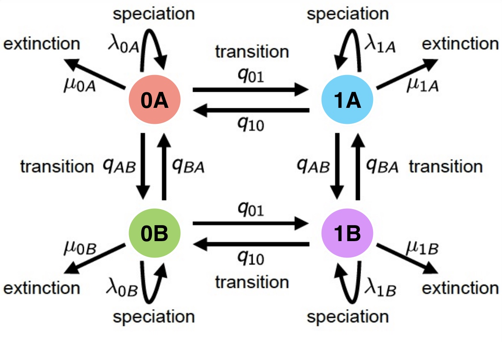

# Presentación: Introducción a Hidden State Speciation and Extinction (HISSE)

[{fig-align="center" width="500"}](../docs/u1_PatDiv/HiSSE.pdf)

Haz clic en la imagen para ver el PDF de la presentación

# Modelo de diversificación con estados escondidos (HISSE)

Uno de los descubrimientos más importantes en el campo de los modelos de diversificación dependientes de estado (SSE) fue hecho por [Rabosky y Goldberg (2015)](https://pubmed.ncbi.nlm.nih.gov/25601943/). Estos autores encontraron, que BiSSE generaba un elevado error tipo I. En estadística este error se refiere a rechazar la hipótesis nula cuando en general la hipótesis es verdadera.

**Modelo HiSSE con dos estados y asociando a dos estados escondidos**

{fig-align="center" width="500"}

-   Si tenemos dos estados 0 y 1, estos se convierten ahora en cuatro estados 0A, 0B, 1A, 1B.

-   Para cada uno de los estados definimos una nueva tasa de especiación $\lambda_{0A}$, $\lambda_{0B}$, $\lambda_{1A}$ y $\lambda_{1B}$.

-   Para cada uno de los estados definimos una nueva tasa de extinción $\mu_{0A}$, $\mu_{0B}$, $\mu_{1A}$ y $\mu_{1B}$.

**Matriz de tasas de transición `Q`**

$$
Q =
\begin{bmatrix}
  - & q_{0A \to 0B} & q_{0A \to 1A} & 0 \\
  q_{0B \to 0A} & - & 0 & q_{0B \to 1B} \\
  q_{1A \to 0A} & 0 & - & q_{1A \to 1B} \\
  0 & q_{1B \to 0B} & q_{1B \to 1A} & -
\end{bmatrix}
$$

La matriz `Q` muestra cómo los estados observables y ocultos interactúan, ayudando a inferir **cómo los cambios de carácter afectan la especiación y extinción**.

**Simulación bajo el modelo HiSSE**

El siguiente script simula un proceso bajo el modelo **HiSSE (Hidden State Speciation and Extinction)**. En este caso se consideran dos estados observados (`0` y `1`) asociados con dos estados ocultos (`A` y `B`), generando cuatro combinaciones posibles:

-   `0A`

-   `0B`

-   `1A`

-   `1B`

📥 Puedes descargar el script en el siguiente enlace:

<a href="../docs/u1_PatDiv/HiSSE.R" download>📥 Descargar script de simulación HiSSE</a>

## **Script -** HiSSE en RevBayes

Crea un script `.Rev` y copia el codigo de la siguiente sección:

``` bash
# ============================================================
# HiSSE en RevBayes
# Character-Dependent Birth-Death Process con estados ocultos
# ============================================================


# ------------------------------------------------------------
# 1. LECTURA DEL ÁRBOL Y DE LOS DATOS DE CARACTERES
# ------------------------------------------------------------

# Leer el árbol filogenético.
# readTrees() devuelve un vector de árboles, por eso se selecciona [1].
T <- readTrees("datos/hisse/ConLyttini.tre")[1]

# Leer la matriz de caracteres observados.
# En este ejemplo se asume un carácter binario con estados 0 y 1.
datos <- readCharacterData("datos/hisse/Traits_conLyttini_01.nex")


# ------------------------------------------------------------
# 2. PARÁMETROS GENERALES DEL MODELO
# ------------------------------------------------------------

# Número total aproximado de especies del grupo.
# Este valor se usa posteriormente para calcular la fracción de muestreo.
NUM_TOTAL_SPECIES = 3000.0

# Número de estados observados del carácter.
# Por ejemplo:
# 0 = ausencia del carácter
# 1 = presencia del carácter
NUM_STATES = 2

# Número de estados ocultos.
# En este caso:
# A y B
NUM_HIDDEN = 2

# Número total de categorías del modelo HiSSE.
#
# Estados observados:
#   0
#   1
#
# Estados ocultos:
#   A
#   B
#
# Combinaciones:
#   0A
#   1A
#   0B
#   1B
#
# Por tanto:
# NUM_RATES = 2 x 2 = 4
NUM_RATES = NUM_STATES * NUM_HIDDEN

# Parámetro que controla la escala del prior jerárquico
# asociado a las diferencias entre estados ocultos.
H = 0.587405


# ------------------------------------------------------------
# 3. EXPANSIÓN DE LOS DATOS PARA INCLUIR ESTADOS OCULTOS
# ------------------------------------------------------------

# Los datos originales contienen únicamente los estados
# observados 0 y 1.
#
# HiSSE introduce estados ocultos que no se observan
# directamente en las puntas.
#
# expandCharacters() expande el espacio de estados para permitir
# combinaciones como:
#
#   0A
#   1A
#   0B
#   1B
#
# Los estados ocultos quedan como desconocidos en las puntas
# y serán inferidos por el modelo.
data_exp <- datos.expandCharacters(NUM_HIDDEN)


# ------------------------------------------------------------
# 4. VECTORES PARA MOVIMIENTOS Y MONITORES
# ------------------------------------------------------------

# Vector donde se almacenarán los movimientos MCMC.
moves = VectorMoves()

# Vector donde se almacenarán los monitores.
monitors = VectorMonitors()


# ------------------------------------------------------------
# 5. INFORMACIÓN BÁSICA DEL ÁRBOL
# ------------------------------------------------------------

# Obtener los taxones presentes en el árbol.
taxa <- T.taxa()

# Longitud total del árbol:
# suma de todas las longitudes de rama.
tree_length <- T.treeLength()

# Valor inicial aproximado para una tasa de diversificación.
#
# Esta cantidad no se utiliza directamente como prior,
# pero sirve como referencia y posteriormente como valor inicial.
rate_mean <- (NUM_TOTAL_SPECIES - 2) / tree_length


# ------------------------------------------------------------
# 6. COMPONENTE DE ESTADOS OCULTOS PARA LAS TASAS
# ------------------------------------------------------------

# El modelo separa las tasas en dos componentes:
#
#   tasa final =
#       componente del estado observado
#       x
#       componente del estado oculto
#
# Por ejemplo:
#
# λ_0A = λ_0 * h_A
# λ_0B = λ_0 * h_B
#
# Esto permite que los estados ocultos modifiquen las tasas
# de especiación y extinción.


# Media en escala logarítmica de la distribución lognormal
# de los multiplicadores asociados a estados ocultos.
#
# ln(1) = 0
#
# Por tanto, antes de la normalización, los multiplicadores
# están centrados alrededor de 1.
ln_speciation_hidden_mean <- ln(1.0)
ln_extinction_hidden_mean <- ln(1.0)


# ------------------------------------------------------------
# 7. VARIACIÓN ENTRE ESTADOS OCULTOS
# ------------------------------------------------------------

# Desviación estándar de los multiplicadores de especiación
# entre los estados ocultos.
#
# Se asigna un prior exponencial.
speciation_hidden_sd ~ dnExponential(1.0 / H)

# Desviación estándar equivalente para extinción.
extinction_hidden_sd ~ dnExponential(1.0 / H)


# Movimientos MCMC para estos parámetros.
moves.append(
    mvScale(
        speciation_hidden_sd,
        lambda=1,
        tune=true,
        weight=2.0
    )
)

moves.append(
    mvScale(
        extinction_hidden_sd,
        lambda=1,
        tune=true,
        weight=2.0
    )
)


# ------------------------------------------------------------
# 8. CONSTRUCCIÓN DE MULTIPLICADORES PARA ESTADOS OCULTOS
# ------------------------------------------------------------

# Se discretiza una distribución lognormal en NUM_HIDDEN categorías.
#
# Con dos estados ocultos, se generan dos multiplicadores:
#
#   h_A
#   h_B
#
# para especiación.
speciation_hidden_unormalized :=
    fnDiscretizeDistribution(
        dnLognormal(
            ln_speciation_hidden_mean,
            speciation_hidden_sd
        ),
        NUM_HIDDEN
    )

# Lo mismo para extinción.
extinction_hidden_unormalized :=
    fnDiscretizeDistribution(
        dnLognormal(
            ln_extinction_hidden_mean,
            extinction_hidden_sd
        ),
        NUM_HIDDEN
    )


# ------------------------------------------------------------
# 9. NORMALIZACIÓN DE LOS MULTIPLICADORES OCULTOS
# ------------------------------------------------------------

# Se dividen los multiplicadores entre su media.
#
# De esta manera:
#
# mean(speciation_hidden) = 1
#
# y
#
# mean(extinction_hidden) = 1
#
# Esto evita que la componente oculta cambie arbitrariamente
# la escala global de las tasas.
speciation_hidden :=
    speciation_hidden_unormalized /
    mean(speciation_hidden_unormalized)

extinction_hidden :=
    extinction_hidden_unormalized /
    mean(extinction_hidden_unormalized)


# ------------------------------------------------------------
# 10. TASAS ASOCIADAS AL CARÁCTER OBSERVADO
# ------------------------------------------------------------

# Se estima una tasa base de especiación y extinción
# para cada estado observado.
#
# En un carácter binario:
#
# speciation_observed[1] = λ_0
# speciation_observed[2] = λ_1
#
# extinction_observed[1] = μ_0
# extinction_observed[2] = μ_1

for (i in 1:NUM_STATES) {

    # --------------------------------------------------------
    # Especiación
    # --------------------------------------------------------

    # Prior log-uniforme muy amplio.
    #
    # Permite explorar tasas entre:
    #
    # 10^-6 y 10^2
    speciation_observed[i] ~ dnLoguniform(1E-6, 1E2)

    # Valor inicial de la cadena.
    #
    # Esto NO modifica el prior.
    # Solo indica el punto desde donde empieza la MCMC.
    speciation_observed[i].setValue(
        (NUM_TOTAL_SPECIES - 2) / tree_length
    )

    # Movimiento multiplicativo apropiado para parámetros positivos.
    moves.append(
        mvScale(
            speciation_observed[i],
            lambda=1.0,
            tune=true,
            weight=3.0
        )
    )


    # --------------------------------------------------------
    # Extinción
    # --------------------------------------------------------

    # Prior log-uniforme para la tasa de extinción.
    extinction_observed[i] ~ dnLoguniform(1E-6, 1E2)

    # Inicialmente se fija la tasa de extinción
    # en una décima parte de la especiación.
    extinction_observed[i].setValue(
        speciation_observed[i] / 10.0
    )

    moves.append(
        mvScale(
            extinction_observed[i],
            lambda=1.0,
            tune=true,
            weight=3.0
        )
    )
}


# ------------------------------------------------------------
# 11. COMBINACIÓN DE ESTADOS OBSERVADOS Y OCULTOS
# ------------------------------------------------------------

# Las tasas finales dependen de:
#
#   estado observado
#   x
#   estado oculto
#
# Para dos estados observados y dos ocultos:
#
# index 1 = 0A
# index 2 = 1A
# index 3 = 0B
# index 4 = 1B

for (j in 1:NUM_HIDDEN) {

    for (i in 1:NUM_STATES) {

        # Convertir la combinación (i,j)
        # en una posición del vector.
        index = i + (j * NUM_STATES) - NUM_STATES

        # Tasa de especiación final.
        speciation[index] :=
            speciation_observed[i] *
            speciation_hidden[j]

        # Tasa de extinción final.
        extinction[index] :=
            extinction_observed[i] *
            extinction_hidden[j]
    }
}


# ------------------------------------------------------------
# 12. TRANSICIONES ENTRE ESTADOS OBSERVADOS
# ------------------------------------------------------------

# Parámetro del prior exponencial para las tasas
# de transición entre estados observados.
rate_pr := T.treeLength() / 10

# Para dos estados observados existen dos posibles transiciones:
#
# 0 -> 1
# 1 -> 0
#
# NUM_STATES * (NUM_STATES - 1)
#
# = 2 * 1
# = 2
for (i in 1:(NUM_STATES * (NUM_STATES - 1))) {

    transition_rates[i] ~ dnExp(rate_pr)

    moves.append(
        mvScale(
            transition_rates[i],
            lambda=0.50,
            tune=true,
            weight=3.0
        )
    )
}


# ------------------------------------------------------------
# 13. TRANSICIÓN ENTRE ESTADOS OCULTOS
# ------------------------------------------------------------

# Una tasa común controla los cambios entre estados ocultos:
#
# A <-> B
hidden_rate ~ dnExponential(rate_pr)

moves.append(
    mvScale(
        hidden_rate,
        lambda=0.5,
        tune=true,
        weight=5
    )
)


# Construir el vector de tasas de transición
# entre estados ocultos.
#
# Con dos estados ocultos:
#
# A -> B
# B -> A
#
# comparten el mismo valor hidden_rate.
for (i in 1:(NUM_HIDDEN * (NUM_HIDDEN - 1))) {
    R[i] := hidden_rate
}


# ------------------------------------------------------------
# 14. MATRIZ DE TRANSICIÓN HIDDEN-STATE
# ------------------------------------------------------------

# Construir la matriz de tasas Q combinando:
#
# transition_rates
#     transiciones entre estados observados
#
# R
#     transiciones entre estados ocultos
#
# rescaled=false indica que la matriz no se reescala
# automáticamente.
rate_matrix :=
    fnHiddenStateRateMatrix(
        transition_rates,
        R,
        rescaled=false
    )


# ------------------------------------------------------------
# 15. FRECUENCIAS EN LA RAÍZ
# ------------------------------------------------------------

# Prior Dirichlet para las probabilidades iniciales
# de los cuatro estados posibles en la raíz:
#
# 0A
# 1A
# 0B
# 1B
#
# rep(1, NUM_RATES) genera:
#
# [1,1,1,1]
#
# que corresponde a un Dirichlet simétrico.
rate_category_prior ~
    dnDirichlet(
        rep(1, NUM_RATES)
    )


# Movimientos MCMC sobre el simplex.
moves.append(
    mvBetaSimplex(
        rate_category_prior,
        tune=true,
        weight=2
    )
)

moves.append(
    mvDirichletSimplex(
        rate_category_prior,
        tune=true,
        weight=2
    )
)


# ------------------------------------------------------------
# 16. EDAD DE LA RAÍZ
# ------------------------------------------------------------

# Obtener la edad de la raíz del árbol observado.
root <- T.rootAge()


# ------------------------------------------------------------
# 17. FRACCIÓN DE MUESTREO
# ------------------------------------------------------------

# rho representa la proporción de especies existentes
# incluidas en el árbol.
#
# Por ejemplo, si:
#
# árbol = 300 especies
# total esperado = 3000 especies
#
# rho = 300 / 3000 = 0.10
#
# es decir, se ha muestreado aproximadamente el 10 %.
rho <- T.ntips() / 3000.0


# ------------------------------------------------------------
# 18. PROCESO DE NACIMIENTO-MUERTE DEPENDIENTE DEL ESTADO
# ------------------------------------------------------------

# Esta es la parte central del modelo HiSSE.
#
# dnCDBDP =
# Character-Dependent Birth-Death Process
#
# El proceso utiliza:
#
# speciationRates
#     tasas de especiación de los estados 0A,1A,0B,1B
#
# extinctionRates
#     tasas de extinción correspondientes
#
# Q
#     matriz de transición entre estados
#
# pi
#     probabilidades de los estados en la raíz
#
# rho
#     fracción de muestreo
#
# condition="survival"
#     condiciona el proceso a que el linaje haya sobrevivido
#     hasta el presente.

timetree ~ dnCDBDP(
    rootAge = root,
    speciationRates = speciation,
    extinctionRates = extinction,
    Q = rate_matrix,
    delta = 1.0,
    pi = rate_category_prior,
    rho = rho,
    condition = "survival"
)


# ------------------------------------------------------------
# 19. CONDICIONAR EL MODELO AL ÁRBOL OBSERVADO
# ------------------------------------------------------------

# El árbol no se estima:
# se fija al árbol filogenético observado.
timetree.clamp(T)


# ------------------------------------------------------------
# 20. CONDICIONAR EL MODELO A LOS CARACTERES OBSERVADOS
# ------------------------------------------------------------

# Asociar los estados observados de las especies
# al proceso de nacimiento-muerte.
timetree.clampCharData(data_exp)


# ------------------------------------------------------------
# 21. CONSTRUIR EL MODELO
# ------------------------------------------------------------

# Construir el grafo probabilístico completo.
mymodel = model(rate_matrix)


# ------------------------------------------------------------
# 22. MONITOR PRINCIPAL
# ------------------------------------------------------------

# Guardar en archivo los parámetros del modelo.
#
# printgen=1 significa que se guarda cada generación.
monitors.append(
    mnModel(
        filename=
        "salida/hisse/mitos_HiSSE_clyttini_TUTscript.log",
        printgen=1
    )
)


# ------------------------------------------------------------
# 23. RECONSTRUCCIÓN DE ESTADOS ANCESTRALES
# ------------------------------------------------------------

# Guardar muestras de los estados ancestrales
# condicionados al árbol y al modelo HiSSE.
#
# type="NaturalNumbers"
# indica que los estados se almacenan como números enteros.
#
# withTips=true
# incluye también los estados de las puntas.
#
# withStartStates=false
# no incluye los estados al inicio de cada rama.
monitors.append(
    mnJointConditionalAncestralState(
        tree=timetree,
        cdbdp=timetree,
        type="NaturalNumbers",
        printgen=1,
        withTips=true,
        withStartStates=false,
        filename=
        "salida/hisse/anc_states_mitos_HiSSE_clyttini_TUTscript.log"
    )
)


# ------------------------------------------------------------
# 24. MAPEO ESTOCÁSTICO DE CARACTERES
# ------------------------------------------------------------

# Generar historias completas de cambio de estado
# a lo largo de las ramas.
#
# A diferencia de una reconstrucción nodal,
# el stochastic character mapping permite inferir:
#
# - dónde ocurrió un cambio
# - cuándo ocurrió
# - cuántos cambios ocurrieron
# - qué estados ocuparon cada segmento de rama
#
# include_simmap=true
# guarda el resultado en formato SIMMAP.
monitors.append(
    mnStochasticCharacterMap(
        cdbdp=timetree,
        printgen=10,
        filename=
        "salida/hisse/stoch_char_map_mitos_HiSSE_clyttini_TUTscript.log",
        include_simmap=true
    )
)


# ------------------------------------------------------------
# 25. MONITOR EN PANTALLA
# ------------------------------------------------------------

# Mostrar durante la ejecución las tasas asociadas
# a los estados observados.
#
# Cada 10 generaciones se imprimen:
#
# λ_0
# λ_1
# μ_0
# μ_1
monitors.append(
    mnScreen(
        printgen=10,
        speciation_observed,
        extinction_observed
    )
)


# ------------------------------------------------------------
# 26. CONFIGURACIÓN DE LA MCMC
# ------------------------------------------------------------

# Construir la cadena MCMC.
#
# nruns=1
#     una sola corrida
#
# moveschedule="random"
#     movimientos seleccionados aleatoriamente
#
# combine="mixed"
#     configuración utilizada para combinar información
#     en modelos de este tipo.
mymcmc = mcmc(
    mymodel,
    monitors,
    moves,
    nruns=1,
    moveschedule="random",
    combine="mixed"
)


# ------------------------------------------------------------
# 27. EJECUTAR LA MCMC
# ------------------------------------------------------------

# Aquí se usan únicamente 400 generaciones.
#
# Esto puede servir para:
#
# - comprobar que el script funciona
# - probar rutas
# - revisar monitores
# - depurar errores
#
# NO es suficiente para una inferencia final.
mymcmc.run(
    generations=400
)


# ============================================================
# POSTPROCESAMIENTO
# ============================================================


# ------------------------------------------------------------
# 28. LEER LAS MUESTRAS DE ESTADOS ANCESTRALES
# ------------------------------------------------------------

anc_states2 =
    readAncestralStateTrace(
        "salida/hisse/anc_states_mitos_HiSSE_clyttini_TUTscript.log"
    )


# ------------------------------------------------------------
# 29. RESUMIR LOS ESTADOS ANCESTRALES EN UN ÁRBOL
# ------------------------------------------------------------

# Construir un árbol donde cada nodo recibe el estado
# ancestral con mayor probabilidad posterior.
#
# summary_statistic="MAP"
#
# MAP =
# Maximum A Posteriori
#
# selecciona el estado con mayor probabilidad posterior
# para cada nodo.
anc_tree =
    ancestralStateTree(
        tree=T,
        ancestral_state_trace_vector=anc_states2,
        include_start_states=false,
        file=
        "salida/hisse/anc_states_mitos_HiSSE_clyttini_TUTscript.tree",
        burnin=2,
        summary_statistic="MAP",
        site=1
    )


# ------------------------------------------------------------
# 30. PARÁMETROS PARA EL MAPEO ESTOCÁSTICO
# ------------------------------------------------------------

# Número de muestras iniciales que se descartan.
burnin=10

# Número de intervalos utilizados para resumir
# probabilidades a lo largo de las ramas.
n_time_slices=500


# ------------------------------------------------------------
# 31. LEER LOS STOCHASTIC CHARACTER MAPS
# ------------------------------------------------------------

anc_states_SCHM =
    readAncestralStateTrace(
        "salida/hisse/stoch_char_map_mitos_HiSSE_clyttini_TUTscript.log"
    )


# ------------------------------------------------------------
# 32. RESUMIR LOS MAPAS ESTOCÁSTICOS
# ------------------------------------------------------------

# characterMapTree() resume las historias simuladas
# de cambio de carácter.
#
# Produce dos archivos:
#
# character_file
#     árbol con reconstrucciones/mapeos marginales
#
# posterior_file
#     árbol con probabilidades posteriores asociadas
#
# Esto permite visualizar cómo cambian los estados
# a lo largo de las ramas.
char_map_tree =
    characterMapTree(
        tree=T,
        ancestral_state_trace_vector=anc_states_SCHM,
        character_file=
        "salida/hisse/stoch_mitos_HiSSE_clyttini_TUTscriptmarginal_char.tree",
        posterior_file=
        "salida/hisse/stoch_mitos_HiSSE_clyttini_TUTscriptmarginal_post.tree",
        burnin=burnin,
        num_time_slices=n_time_slices
    )
```

## Visualización en R con RevGadgets

```{r, results='hide'}
library(RevGadgets)
library(ggplot2)
library(ggtree)
library(grid)

# Cargar el archivo de estados ancestrales
hisse_file <- paste0("../docs/u1_PatDiv/output/hisse/anc_states_mitos_HiSSE_clyttini_TUTscript.tree")

p_anc_hisse <- processAncStates(hisse_file)

# Definir paleta de colores personalizada
traitcols <- c("#F29494", "#5FD9D9", "#9DD962", "#D48DF2")  # Rojo para estado 0, azul para estado 1

# Generar el gráfico con estados ancestrales
plot_hisse <- plotAncStatesMAP(p_anc_hisse,
        tree_layout = "rect",
        tip_labels_size = 1) +
        # Aplicar la paleta de colores
        scale_color_manual(values = traitcols) +
        scale_fill_manual(values = traitcols) +
        # Modificar leyenda y otros elementos de ggplot2
        theme(legend.position = c(0.1, 0.85),
              legend.key.size = unit(0.3, 'cm'), # Tamaño de la clave de la leyenda
              legend.title = element_text(size = 6), # Tamaño del título de la leyenda
              legend.text = element_text(size = 4))  # Tamaño del texto de la leyenda

# Mostrar el gráfico
plot_hisse

# Generar el gráfico con ramas coloreadas por estado ancestral
plot_hisse_2 <- ggtree(p_anc_hisse, layout = "rectangular", aes(color = anc_state_1)) +
  scale_color_manual(name = "Estado", values = traitcols) +  
  theme_minimal() +
  ggtitle("HISSE") +
  theme(legend.position = c(0.1, 0.85),
        legend.key.size = unit(0.3, 'cm'), # Tamaño de la clave de la leyenda
        legend.title = element_text(size = 6), # Tamaño del título de la leyenda
        legend.text = element_text(size = 4))  # Tamaño del texto de la leyenda

# Mostrar el gráfico
plot_hisse_2
```


## Graficar las tasas de diversificación neta

```{r}
# Leer el archivo de salida de RevBayes
hisse <- read.table("../docs/u1_PatDiv/output/hisse/mitos_HiSSE_clyttini_TUTscript.log", header = TRUE)

# Definir paleta de colores personalizada
traitcols <- c("#F29494", "#5FD9D9", "#9DD962", "#D48DF2")  # Rojo para estado 0, azul para estado 1

# Calcular la tasa de diversificación neta: especiación - extinción
netdiversification_rates <- data.frame(
  dens = c(
    # 0A
    hisse$speciation.1. - hisse$extinction.1.,

    # 1A
    hisse$speciation.2. - hisse$extinction.2.,

    # 0B
    hisse$speciation.3. - hisse$extinction.3.,

    # 1B
    hisse$speciation.4. - hisse$extinction.4.

  ),
  
  rate = rep(c("0A", "1A", "0B", "1B"), each = length(hisse$speciation_observed.1.))
  )

# Convertir la variable de estado en factor
netdiversification_rates$rate <- factor(netdiversification_rates$rate, levels = c("0A", "1A", "0B", "1B"))

# Crear el gráfico de violín para tasas de diversificación neta
violin_diversification <- ggplot(netdiversification_rates, aes(x = rate, y = dens, fill = rate)) +
  geom_violin(trim = FALSE) +
  labs(title = "Tasas de Diversificación Neta", x = "Estado", y = "Tasa") +
  scale_fill_manual(name = "Estado", values = traitcols) +
  theme_classic()

# Mostrar la gráfica
violin_diversification
```

## Graficar tasas de especiación

```{r}
# Crear un dataframe con tasas de especiación para cada estado
# Tasas de especiación finales de HiSSE
speciation_rates <- data.frame(
  dens = c(
    # 0A
    hisse$speciation.1.,
    
    # 1A
    hisse$speciation.2.,
    
    # 0B
    hisse$speciation.3.,
    
    # 1B
    hisse$speciation.4.
  ),
  
  rate = rep(
    c("0A", "1A", "0B", "1B"),
    each = nrow(hisse)
  )
)

speciation_rates$rate <- factor(
  speciation_rates$rate,
  levels = c("0A", "1A", "0B", "1B")
)

# Crear gráfico de violín para las tasas de especiación
violin_speciation <- ggplot(
  speciation_rates,
  aes(x = rate, y = dens, fill = rate)
) +
  geom_violin(trim = FALSE) +
  labs(
    title = "Tasas de Especiación",
    x = "Estado",
    y = "Tasa de Especiación"
  ) +
  scale_fill_manual(
    name = "Estado",
    values = traitcols
  ) +
  theme_classic()

# Mostrar la gráfica
violin_speciation
```

## Graficar tasas de extinción

```{r}
# Crear un dataframe con tasas de extinción para cada estado
extinction_rates <- data.frame(
  dens = c(
    # 0A
    hisse$extinction.1.,
    
    # 1A
    hisse$extinction.2.,
    
    # 0B
    hisse$extinction.3.,
    
    # 1B
    hisse$extinction.4.
  ),
  
  rate = rep(
    c("0A", "1A", "0B", "1B"),
    each = nrow(hisse)
  )
)

extinction_rates$rate <- factor(
  extinction_rates$rate,
  levels = c("0A", "1A", "0B", "1B")
)

# Crear gráfico de violín para tasas de extinción
violin_extinction <- ggplot(
  extinction_rates,
  aes(x = rate, y = dens, fill = rate)
) +
  geom_violin(trim = FALSE) +
  labs(
    title = "Tasas de Extinción",
    x = "Estado",
    y = "Tasa de Extinción"
  ) +
  scale_fill_manual(
    name = "Estado",
    values = traitcols
  ) +
  theme_classic()

# Mostrar la gráfica
violin_extinction
```
