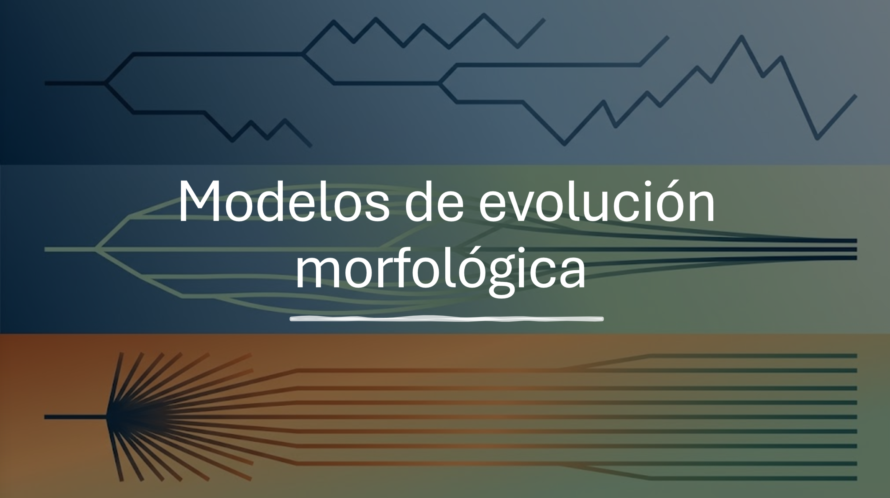

# Presentación: Introducción a patrones morfológicos

[{fig-align="center" width="500"}](../docs/u3_PatMorph/Evolucion_caracteres.pdf)

Haz clic en la imagen para consultar la presentación.

## Introducción

En biología evolutiva, los caracteres de los organismos pueden representarse como rasgos **discretos** (por ejemplo, el tipo de dieta, el hábitat o el sistema de apareamiento) o **continuos** (como el tamaño corporal, la longitud de una estructura o la masa corporal). Analizar cómo estos caracteres han cambiado a lo largo del tiempo nos ayuda a estudiar los patrones que han moldeado la diversidad biológica actual.

La reconstrucción de estados ancestrales permite estimar los valores o estados que pudieron tener los ancestros comunes de las especies actuales. Para ello, utilizamos modelos estadísticos que describen cómo evolucionan los caracteres sobre un árbol filogenético.

**Objetivo de la sesión:** conocer los componentes básicos de dos modelos de evolución de caracteres continuos, **movimiento browniano (BM)** y **Ornstein–Uhlenbeck (OU)**, mediante la estimación de parámetros en RevBayes y su interpretación con R. Al final se conserva un ejercicio complementario de evolución de caracteres discretos, cuya teoría se abordará posteriormente.

## Modelos de evolución de caracteres continuos

Los modelos de esta práctica pertenecen a la familia de **modelos gaussianos**: bajo sus supuestos, los valores del carácter pueden describirse mediante distribuciones normales condicionadas por el tiempo evolutivo y la filogenia.

- **Movimiento browniano (BM):** representa cambios estocásticos del carácter sin una dirección preferida. La varianza de los cambios es proporcional al tiempo. En esta práctica estimaremos una sola tasa de evolución compartida por todas las ramas.
- **Ornstein–Uhlenbeck (OU):** incorpora, además del componente estocástico, una tendencia hacia un valor óptimo del carácter. En esta práctica utilizaremos un único óptimo, constante en todo el árbol.

En ambos casos, el árbol filogenético se considera **conocido y fijo**. Las estimaciones estarán condicionadas a ese árbol y a las distribuciones a priori elegidas. Un buen ajuste de un modelo no demuestra por sí mismo un mecanismo evolutivo específico.

### Datos morfológicos de Eupomphini

Utilizaremos datos morfológicos del trabajo [*Analyses of head and thorax in Eupomphini (Meloidae) suggest that complex behaviors are not associated to changes in general shape*](https://doi.org/10.1111/1749-4877.12708). La matriz `med_geiger.nex` contiene **21 taxones** y **4 caracteres continuos**: **volumen de élitros**, **volumen del abdomen**, **amplitud** y **convexidad**, en ese orden. El archivo `subarbol_ingroup_morph.nex` contiene la filogenia utilizada en la práctica.

Descarga los archivos de trabajo:

- [📥 Árbol filogenético (`subarbol_ingroup_morph.nex`)](../docs/u1_PatDiv/output/morpho/subarbol_ingroup_morph.nex)
- [📥 Matriz de caracteres continuos (`med_geiger.nex`)](../docs/u1_PatDiv/output/morpho/med_geiger.nex)


## Modelo browniano (BM) de tasa constante en RevBayes

El **movimiento browniano** supone que un carácter cambia de manera estocástica, sin una tendencia sistemática hacia valores mayores o menores.

Para una rama de duración $t$:

$$
E[\Delta X] = 0
$$

$$
\operatorname{Var}(\Delta X)=\sigma^2 t
$$

Donde:

- $t$ es la longitud temporal de la rama.
- $\sigma^2$ es la **tasa de varianza evolutiva** por unidad de tiempo.
- $\Delta X$ es el cambio del carácter durante esa rama.

Un valor mayor de $\sigma^2$ implica una mayor dispersión esperada de los cambios **a la misma escala temporal y para el mismo tipo de carácter**. No significa necesariamente que la evolución haya sido causada por deriva genética.

En un análisis bayesiano, contrastamos dos distribuciones:

- **A priori (prior):** valores considerados plausibles para $\sigma^2$ antes de condicionar el modelo a los datos observados.
- **Posterior:** valores plausibles para $\sigma^2$ después de incorporar los datos y el modelo.

### 1. Script de la distribución posterior (`mcmc_BM.Rev`)

Este análisis utiliza la filogenia, los valores observados y una distribución a priori para estimar $\sigma^2$.

En `data.includeCharacter(trait)` podemos elegir cualquiera de los cuatro caracteres, indicando `trait <- 1`, `2`, `3` o `4`.

La prior de $\sigma^2$ se amplía respecto del ejemplo original para evitar que el límite superior de 0.1 restrinja innecesariamente las estimaciones de los caracteres 1 y 2.

```r
################################################################################
# mcmc_BM.Rev
# Inferencia bayesiana de la tasa de evolución bajo BM de tasa constante
################################################################################

# 1. Datos y filogenia
trait <- 1
T <- readTrees("../data/subarbol_ingroup_morph.nex")[1]
data <- readContinuousCharacterData("../data/med_geiger.nex")
data.excludeAll()
data.includeCharacter(trait)

# 2. Movimientos y monitores
moves    = VectorMoves()
monitors = VectorMonitors()
tree <- T

# 3. Tasa de varianza evolutiva: sigma2 = sigma^2
sigma2 ~ dnLoguniform(1e-5, 1.0)
moves.append( mvScale(sigma2, weight=1.0) )

# 4. Modelo browniano con verosimilitud REML
# La función recibe sigma = sqrt(sigma2), no sigma2.
X ~ dnPhyloBrownianREML(tree, branchRates=sqrt(sigma2))

# 5. Condicionar el modelo a los datos observados
X.clamp(data)
mymodel = model(sigma2)

# 6. Monitores
monitors.append( mnModel(filename="../out/morpho/simple_BM.log", printgen=10) )
monitors.append( mnScreen(printgen=100, sigma2) )

# 7. MCMC: dos ejecuciones
mymcmc = mcmc(mymodel, monitors, moves, nruns=2, combine="mixed")
mymcmc.run(generations=10000)

q()
```

**¿Qué hace `X.clamp(data)`?** Fija los valores observados del carácter al nodo de datos. Esto hace que la verosimilitud de esos datos influya en la distribución posterior de $\sigma^2$.

**¿Qué significa REML aquí?** Es un procedimiento eficiente para calcular la verosimilitud del modelo continuo sin estimar explícitamente todos los estados internos. En esta práctica su objetivo es estimar los parámetros de evolución del carácter, no reconstruir estados ancestrales continuos.

### 2. Script de la distribución a priori (`mcmc_BM_prior.Rev`)

Utilizaremos **la misma prior** de $\sigma^2$, pero sin condicionar el modelo a los datos observados. La instrucción `mymodel.ignoreAllData()` permite recorrer la distribución a priori del modelo.

```r
################################################################################
# mcmc_BM_prior.Rev
# Muestreo de la distribución a priori de sigma2 bajo BM
################################################################################

T <- readTrees("../data/subarbol_ingroup_morph.nex")[1]
tree <- T

moves    = VectorMoves()
monitors = VectorMonitors()

# Misma prior que en el análisis posterior
sigma2 ~ dnLoguniform(1e-5, 1.0)
moves.append( mvScale(sigma2, weight=1.0) )

X ~ dnPhyloBrownianREML(tree, branchRates=sqrt(sigma2))

mymodel = model(sigma2)
mymodel.ignoreAllData()

monitors.append( mnModel(filename="../out/morpho/simple_BM_prior.log", printgen=10) )
monitors.append( mnScreen(printgen=100, sigma2) )

mymcmc = mcmc(mymodel, monitors, moves, nruns=2, combine="mixed")
mymcmc.run(generations=10000)

q()
```

### 3. Visualización de la prior y la posterior de $\sigma^2$ en R

Para evitar confundir muestras de la prior con muestras de la posterior, construiremos una tabla con una columna que identifique su procedencia y compararemos las densidades. Descartaremos inicialmente un **25 % de las muestras** de cada análisis como burn-in; esta proporción es ilustrativa y no sustituye la revisión de las trazas MCMC.

```{r}
#| label: configurar-rutas-trazas
#| include: false

# Este bloque se reutiliza para BM y OU.
rutas_resultados <- c(
  "../docs/u1_PatDiv/output/morpho",
  "../out/morpho"
)

buscar_archivo <- function(nombre) {
  opciones <- file.path(rutas_resultados, nombre)
  disponibles <- opciones[file.exists(opciones)]
  if (length(disponibles) == 0) NA_character_ else disponibles[[1]]
}

leer_traza <- function(nombre, burnin = 0.25) {
  ruta <- buscar_archivo(nombre)
  if (is.na(ruta)) return(NULL)
  if (!requireNamespace("RevGadgets", quietly = TRUE)) {
    message("Instala RevGadgets para leer las trazas de RevBayes.")
    return(NULL)
  }
  resultado <- RevGadgets::readTrace(ruta, burnin = burnin)
  if (is.data.frame(resultado)) return(resultado)
  do.call(rbind, lapply(resultado, as.data.frame))
}
```

```{r}
#| label: grafica-bm-prior-posterior
#| fig-cap: "Distribuciones a priori y posterior de la tasa de evolución bajo BM."

library(ggplot2)

bm_post  <- leer_traza("simple_BM.log")
bm_prior <- leer_traza("simple_BM_prior.log")

if (!is.null(bm_post) && !is.null(bm_prior)) {
  tasas_bm <- rbind(
    data.frame(sigma2 = bm_prior$sigma2, distribucion = "A priori"),
    data.frame(sigma2 = bm_post$sigma2,  distribucion = "Posterior")
  )

  ggplot(tasas_bm, aes(x = sigma2, fill = distribucion, colour = distribucion)) +
    geom_density(alpha = 0.20) +
    labs(x = expression(sigma^2), y = "Densidad",
         fill = "Distribución", colour = "Distribución") +
    theme_minimal()
} else {
  message("Las trazas BM aún no están disponibles: ejecuta primero los scripts de RevBayes.")
}
```

**Interpretación:**

- Si la posterior es más concentrada que la prior, los datos redujeron la incertidumbre sobre $\sigma^2$.
- Si la posterior está cerca de un límite de la prior, conviene revisar los límites elegidos.
- Si ambas distribuciones son muy similares, los datos podrían contener poca información para estimar este parámetro.
- Antes de interpretar los resultados definitivos debemos verificar que las cadenas MCMC hayan explorado adecuadamente la posterior (trazas, mezcla y tamaño efectivo de muestra, ESS).

**Actividad breve:** cambia `trait <- 1` por otro carácter y repite los análisis. ¿El valor estimado de $\sigma^2$ cambia? ¿Se puede comparar directamente su magnitud entre caracteres medidos en escalas diferentes?

## Modelo Ornstein–Uhlenbeck (OU) simple en RevBayes

El modelo de **Ornstein–Uhlenbeck (OU)** extiende BM agregando una tendencia hacia un valor óptimo $\theta$. La evolución sigue siendo estocástica, pero ahora incorpora una fuerza de atracción:

$$
dX(t)=\alpha[\theta-X(t)]\,dt+\sigma\,dB(t)
$$

Los tres parámetros principales son:

| Parámetro | Interpretación |
|---|---|
| $\theta$ (*theta*) | Valor óptimo hacia el que tiende el carácter. |
| $\alpha$ (*alpha*) | Intensidad de atracción hacia el óptimo, en unidades inversas de tiempo. |
| $\sigma^2$ (*sigma2*) | Varianza de difusión estocástica por unidad de tiempo. |

Si $\alpha=0$, OU se reduce a BM. En esta práctica suponemos que existe **un único óptimo constante para todos los linajes**. OU puede representar selección estabilizadora, pero estimar $\alpha>0$ no constituye por sí solo una demostración de selección natural.

### Vida media filogenética y varianza estacionaria

La **vida media filogenética** expresa cuánto tarda en reducirse a la mitad la influencia del valor ancestral sobre el valor esperado del carácter:

$$
t_{1/2}=\frac{\ln(2)}{\alpha}
$$

No representa un tiempo exacto para alcanzar $\theta$: el proceso continúa sujeto a fluctuaciones estocásticas.

Bajo un OU homogéneo, a tiempos suficientemente largos, la varianza se aproxima a:

$$
V_{\infty}=\frac{\sigma^2}{2\alpha}
$$

Esta expresión muestra que $\alpha$ y $\sigma^2$ pueden compensarse: valores más altos de ambos parámetros pueden producir la misma varianza estacionaria. Por ello, es útil examinar **su distribución posterior conjunta**.

### 1. Script de la distribución posterior (`mcmc_OU.Rev`)

Conservaremos la prior log-uniforme de $\sigma^2$ utilizada en BM, para mantener el ejercicio sencillo. Para $\alpha$ utilizaremos una **prior lognormal** centrada, en términos de su **mediana**, en una vida media filogenética equivalente a la mitad de la altura del árbol.

**Detalle de parametrización:** en RevBayes, `dnLognormal(mean, sd)` recibe la media **en escala logarítmica**. Por ello debe utilizarse `ln(...)` al especificar la mediana deseada de $\alpha$.

```r
################################################################################
# mcmc_OU.Rev
# Inferencia de parámetros de OU de óptimo único
################################################################################

# 1. Datos y filogenia
trait <- 1
T <- readTrees("../data/subarbol_ingroup_morph.nex")[1]
data <- readContinuousCharacterData("../data/med_geiger.nex")
data.excludeAll()
data.includeCharacter(trait)

tree <- T
root_age := tree.rootAge()

moves    = VectorMoves()
monitors = VectorMonitors()

# 2. Componente estocástico: sigma2
sigma2 ~ dnLoguniform(1e-5, 1.0)
moves.append( mvScale(sigma2, weight=2.0) )

# 3. Atracción hacia el óptimo: alpha
# Mediana de alpha = ln(2)/(root_age/2)
# Equivale a mediana de t_half = root_age/2.
# dnLognormal utiliza el logaritmo de la mediana.
alpha_median := ln(2.0) / (0.5 * root_age)
alpha ~ dnLognormal(ln(alpha_median), 1.1748)
moves.append( mvScale(alpha, weight=2.0) )

# 4. Óptimo del carácter: theta
# Intervalo amplio para las escalas de los cuatro caracteres de esta matriz.
theta ~ dnUniform(-10.0, 10.0)
moves.append( mvSlide(theta, weight=2.0) )

# 5. Movimiento multivariado para mejorar la mezcla MCMC
avmvn_move = mvAVMVN(weight=5, waitBeforeLearning=500, waitBeforeUsing=1000)
avmvn_move.addVariable(sigma2)
avmvn_move.addVariable(alpha)
avmvn_move.addVariable(theta)
moves.append(avmvn_move)

# 6. Cantidades derivadas para interpretar OU
t_half := ln(2.0) / alpha
vy := sigma2 / (2.0 * alpha)

# Fracción de reducción de varianza acumulada respecto de BM
# bajo las condiciones particulares de este modelo (0 a 1).
p_th := 1.0 - (1.0 - exp(-2.0 * alpha * root_age)) / (2.0 * alpha * root_age)

# 7. Verosimilitud del modelo OU, con REML
# Se supone que en la raíz el carácter inicia en theta.
X ~ dnPhyloOrnsteinUhlenbeckREML(
  tree, alpha, theta, sqrt(sigma2), rootStates=theta
)
X.clamp(data)

mymodel = model(theta)

# 8. Monitores
monitors.append( mnModel(filename="../out/morpho/simple_OU.log", printgen=10) )
monitors.append( mnScreen(printgen=1000, sigma2, alpha, theta) )

# 9. MCMC
mymcmc = mcmc(mymodel, monitors, moves, nruns=2, combine="mixed")
mymcmc.run(generations=50000)

q()
```

**Supuesto importante:** `rootStates=theta` fija el estado del carácter en la raíz al óptimo. En esta práctica no estimamos de manera independiente ese estado ancestral.

### 2. Script de la distribución a priori (`mcmc_OU_prior.Rev`)

Se conservan **exactamente las mismas priors** de $\sigma^2$, $\alpha$ y $\theta$, pero no se condiciona el modelo a los caracteres observados.

```r
################################################################################
# mcmc_OU_prior.Rev
# Muestreo de las distribuciones a priori del modelo OU
################################################################################

T <- readTrees("../data/subarbol_ingroup_morph.nex")[1]
tree <- T
root_age := tree.rootAge()

moves    = VectorMoves()
monitors = VectorMonitors()

# Mismas priors que en mcmc_OU.Rev
sigma2 ~ dnLoguniform(1e-5, 1.0)
moves.append( mvScale(sigma2, weight=2.0) )

alpha_median := ln(2.0) / (0.5 * root_age)
alpha ~ dnLognormal(ln(alpha_median), 1.1748)
moves.append( mvScale(alpha, weight=2.0) )

theta ~ dnUniform(-10.0, 10.0)
moves.append( mvSlide(theta, weight=2.0) )

avmvn_move = mvAVMVN(weight=5, waitBeforeLearning=500, waitBeforeUsing=1000)
avmvn_move.addVariable(sigma2)
avmvn_move.addVariable(alpha)
avmvn_move.addVariable(theta)
moves.append(avmvn_move)

# Variables derivadas
t_half := ln(2.0) / alpha
vy := sigma2 / (2.0 * alpha)
p_th := 1.0 - (1.0 - exp(-2.0 * alpha * root_age)) / (2.0 * alpha * root_age)

X ~ dnPhyloOrnsteinUhlenbeckREML(
  tree, alpha, theta, sqrt(sigma2), rootStates=theta
)

mymodel = model(theta)
mymodel.ignoreAllData()

monitors.append( mnModel(filename="../out/morpho/simple_OU_prior.log", printgen=10) )
monitors.append( mnScreen(printgen=1000, sigma2, alpha, theta) )

mymcmc = mcmc(mymodel, monitors, moves, nruns=2, combine="mixed")
mymcmc.run(generations=50000)

q()
```

### 3. Visualización de parámetros de OU en R

Compararemos las distribuciones a priori y posterior de $\alpha$, $\theta$, $\sigma^2$ y la fracción $p_{th}$. También observaremos la distribución de la vida media filogenética $t_{1/2}$.

```{r}
#| label: grafica-ou-prior-posterior
#| fig-cap: "Distribuciones a priori y posterior de los parámetros de OU."

library(ggplot2)

ou_post  <- leer_traza("simple_OU.log")
ou_prior <- leer_traza("simple_OU_prior.log")

if (!is.null(ou_post) && !is.null(ou_prior)) {
  graficar_parametro <- function(parametro, nombre) {
    datos <- rbind(
      data.frame(valor = ou_prior[[parametro]], distribucion = "A priori"),
      data.frame(valor = ou_post[[parametro]],  distribucion = "Posterior")
    )
    ggplot(datos, aes(x = valor, fill = distribucion, colour = distribucion)) +
      geom_density(alpha = 0.20) +
      labs(x = nombre, y = "Densidad", fill = "Distribución",
           colour = "Distribución") +
      theme_minimal()
  }

  p_alpha  <- graficar_parametro("alpha", "alpha")
  p_theta  <- graficar_parametro("theta", "theta")
  p_sigma2 <- graficar_parametro("sigma2", "sigma²")
  p_pth    <- graficar_parametro("p_th", "Reducción de varianza (fracción)")

  if (requireNamespace("gridExtra", quietly = TRUE)) {
    gridExtra::grid.arrange(p_alpha, p_theta, p_sigma2, p_pth, ncol = 2)
  } else {
    print(p_alpha)
    print(p_theta)
    print(p_sigma2)
    print(p_pth)
  }
} else {
  message("Las trazas OU aún no están disponibles: ejecuta primero los scripts de RevBayes.")
}
```

```{r}
#| label: grafica-vida-media-ou
#| fig-cap: "Distribuciones de la vida media filogenética (escala logarítmica)."

if (!is.null(ou_post) && !is.null(ou_prior)) {
  datos_vida_media <- rbind(
    data.frame(t_half = ou_prior$t_half, distribucion = "A priori"),
    data.frame(t_half = ou_post$t_half,  distribucion = "Posterior")
  )

  ggplot(datos_vida_media, aes(x = t_half, fill = distribucion,
                               colour = distribucion)) +
    geom_density(alpha = 0.20) +
    scale_x_log10() +
    labs(x = "Vida media filogenética (escala log10)",
         y = "Densidad", fill = "Distribución", colour = "Distribución") +
    theme_minimal()
}
```

**Guía de interpretación:**

- **$\theta$:** ¿en qué región de valores se concentra el óptimo estimado?
- **$\alpha$:** ¿qué valores de intensidad de atracción son compatibles con los datos?
- **$\sigma^2$:** ¿qué tan amplia es la distribución de la tasa estocástica?
- **$t_{1/2}$:** ¿cuánto tarda en disminuir a la mitad la influencia del estado ancestral sobre el valor esperado del carácter?
- **$p_{th}$:** ¿qué fracción de la varianza esperada bajo BM se reduce en este modelo OU durante un intervalo equivalente a la altura del árbol? Multiplica por 100 para expresarla como porcentaje. No es una medida directa de la intensidad de selección natural.

### 4. Relación entre $\alpha$ y $\sigma^2$

```{r}
#| label: correlacion-ou
#| fig-cap: "Distribución posterior conjunta de alpha y sigma2."

if (!is.null(ou_post)) {
  ggplot(ou_post, aes(x = alpha, y = sigma2)) +
    geom_point(alpha = 0.25, size = 0.8) +
    theme_minimal() +
    labs(x = expression(alpha), y = expression(sigma^2),
         title = "Distribución posterior conjunta")
}
```

Como $V_{\infty}=\sigma^2/(2\alpha)$, una misma varianza estacionaria puede explicarse con valores mayores de **ambos** parámetros. Por esta razón, es posible encontrar **correlación positiva** entre $\alpha$ y $\sigma^2$ en la posterior. Sin embargo, su dirección e intensidad deben observarse en los resultados; no están garantizadas para todos los conjuntos de datos.

**Actividad breve:** identifica si los parámetros están correlacionados. ¿Qué implicaría esto para interpretar por separado la tasa estocástica y la fuerza de atracción hacia el óptimo?

### Reflexión final sobre BM y OU

En esta sesión no realizaremos una comparación formal de modelos. Nuestro objetivo es **comprender sus parámetros y practicar su estimación**. Recordemos que observar una concentración posterior para $\alpha$ o $\theta$ no demuestra por sí solo selección estabilizadora: las conclusiones están condicionadas al modelo y al árbol utilizados.

---

## Modelos de evolución de caracteres discretos

> **Actividad complementaria:** conservamos este ejercicio como una introducción operativa a RevBayes para caracteres discretos. La teoría de cadenas de Markov, modelos de transición y reconstrucción de estados ancestrales se revisará en una sesión posterior.

Los modelos de evolución morfológica discreta son útiles para inferir la historia de caracteres con estados definidos, como tipos de dieta o sistemas de apareamiento. También permiten formular hipótesis sobre transiciones **reversibles**, **asimétricas** o **irreversibles**. Por ejemplo, pueden utilizarse para estudiar hipótesis relacionadas con la **ley de Dollo**, que considera restricciones sobre la recuperación evolutiva de ciertos caracteres complejos.

Además, permiten **estimar estados ancestrales** a partir de los estados observados en especies actuales y de un árbol filogenético. En un enfoque probabilístico, la incertidumbre sobre las historias no observadas se incorpora mediante el modelo evolutivo, en lugar de escoger una única historia sin incertidumbre.

### Estimación de estados ancestrales en primates

Trabajaremos con un carácter discreto binario relacionado con la vida solitaria en primates:

- **0:** vida en grupo.
- **1:** vida solitaria.

Nuestro objetivo inmediato es reconstruir los estados ancestrales bajo un **modelo de tasas iguales (ERM)**. La comparación con modelos de tasas diferentes o irreversibles quedará para una práctica posterior.

Para dos estados, el modelo ERM utiliza la matriz de tasas:

$$
Q=\begin{pmatrix}
-\mu & \mu \\
\mu & -\mu
\end{pmatrix}
$$

Equivale a escribir los elementos diagonales como $-(k-1)\mu$ cuando $k=2$. Las entradas fuera de la diagonal indican la tasa instantánea de cambio entre estados. Es una versión sencilla del modelo de Markov para caracteres discretos, conceptualmente análoga al modelo simétrico más simple de sustitución de nucleótidos.

En este ejercicio **fijamos** las probabilidades en la raíz en $(0.5,0.5)$; no las estimamos como parámetros adicionales.

Descarga los archivos de trabajo:

- [📥 Árbol de primates (`primates_tree.nex`)](../docs/u1_PatDiv/output/morpho/primates_tree.nex)
- [📥 Matriz de estados (`primates_solitariness.nex`)](../docs/u1_PatDiv/output/morpho/primates_solitariness.nex)

Copia ambos archivos a `data/` antes de ejecutar el script.

### 1. Script de RevBayes para el modelo ERM (`mcmc_ERM.Rev`)

```r
################################################################################
# mcmc_ERM.Rev
# Estimación de tasas y estados ancestrales bajo un modelo ERM de dos estados
################################################################################

# 1. Datos
CHARACTER = "solitariness"
NUM_STATES = 2

morpho <- readDiscreteCharacterData("../data/primates_" + CHARACTER + ".nex")
phylogeny <- readTrees("../data/primates_tree.nex")[1]

moves    = VectorMoves()
monitors = VectorMonitors()

# 2. Tasa global de transición
# dnExp usa una TASA lambda, de modo que E[mu] = 1/lambda.
# Este valor fija aproximadamente 10 transiciones esperadas en el árbol
# bajo la prior, en el sentido ilustrativo del tutorial original.
rate_pr := phylogeny.treeLength() / 10.0
mu ~ dnExp(rate_pr)
moves.append( mvScale(mu, weight=2.0) )

# 3. Construcción de la matriz Q (todas las transiciones con tasa mu)
NUM_RATES = NUM_STATES * (NUM_STATES - 1)
for (i in 1:NUM_RATES) {
  rate[i] := mu
}
Q_morpho := fnFreeK(rate, rescale=false)

# 4. Frecuencias fijas e iguales en la raíz
rf_prior <- rep(1, NUM_STATES)
rf <- simplex(rf_prior)

# 5. Modelo de Markov en tiempo continuo condicionado a los datos
phyMorpho ~ dnPhyloCTMC(
  tree=phylogeny,
  Q=Q_morpho,
  rootFrequencies=rf,
  type="Standard"
)
phyMorpho.clamp(morpho)

mymodel = model(phylogeny)

# 6. Monitores
monitors.append( mnModel(
  filename="../out/morpho/solitariness_ERM.log", printgen=10
) )
monitors.append( mnScreen(printgen=1000, mu) )

# Muestrear estados ancestrales condicionales en los nodos
monitors.append( mnJointConditionalAncestralState(
  tree=phylogeny,
  ctmc=phyMorpho,
  filename="../out/morpho/solitariness_ERM.states.txt",
  type="Standard",
  printgen=10,
  withTips=true,
  withStartStates=false
) )

# 7. MCMC
mymcmc = mcmc(mymodel, monitors, moves, nruns=2, combine="mixed")
mymcmc.run(generations=25000, tuningInterval=200)

# 8. Resumen de estados ancestrales en un árbol anotado
anc_states = readAncestralStateTrace(
  "../out/morpho/solitariness_ERM.states.txt"
)

anc_tree = ancestralStateTree(
  tree=phylogeny,
  ancestral_state_trace_vector=anc_states,
  include_start_states=false,
  file="../out/morpho/solitariness_ase_ERM.tree",
  burnin=0.25,
  summary_statistic="MAP",
  site=1
)

q()
```

**¿Qué produce el script?** Un registro de la tasa $\mu$ y un árbol anotado que resume la reconstrucción de estados ancestrales. Los estados de los nodos internos son inferencias **condicionadas al árbol, al modelo ERM y a los datos observados**, no observaciones directas del pasado.

### 2. Visualización de estados ancestrales en R con RevGadgets

En este caso sí mostraremos la reconstrucción sobre la filogenia. Podemos visualizar el estado de máxima probabilidad posterior (**MAP**) o las probabilidades de ambos estados mediante gráficos circulares.

```{r}
#| label: graficas-estados-ancestrales
#| fig-cap: "Reconstrucción de estados ancestrales del carácter de vida solitaria en primates."

ruta_arbol_ase <- buscar_archivo("solitariness_ase_ERM.tree")

if (!is.na(ruta_arbol_ase) && requireNamespace("RevGadgets", quietly = TRUE)) {
  library(ggplot2)

  ase <- RevGadgets::processAncStates(
    ruta_arbol_ase,
    state_labels = c("0" = "grupo", "1" = "solitario")
  )

  # Estado MAP en cada nodo
  p1 <- RevGadgets::plotAncStatesMAP(
    t = ase, tree_layout = "rect", tip_labels_size = 1
  ) + theme(legend.position = c(0.92, 0.81))

  print(p1)
  ggsave("primates_solitariness_ASE_ERM_MAP.pdf", p1,
         width = 11, height = 9)

  # Representación alternativa de la incertidumbre
  p2 <- RevGadgets::plotAncStatesPie(
    t = ase, tree_layout = "rect", tip_labels_size = 1
  ) + theme(legend.position = c(0.92, 0.81))

  print(p2)
  ggsave("primates_solitariness_ASE_ERM_Pie.pdf", p2,
         width = 11, height = 9)
} else {
  message("El árbol anotado de estados ancestrales todavía no está disponible.")
}
```

**Para interpretar la figura:** el estado MAP es el estado individual con mayor probabilidad posterior en un nodo; no implica necesariamente certeza. Los gráficos de pastel conservan la información sobre la incertidumbre entre los dos estados.

---

## Referencias y materiales de apoyo

- [RevBayes: Simple Brownian Rate Estimation](https://revbayes.github.io/tutorials/cont_traits/simple_bm.html).
- [RevBayes: Simple Ornstein–Uhlenbeck Models](https://revbayes.github.io/tutorials/cont_traits/simple_ou.html).
- [RevBayes: Discrete morphology – Ancestral State Estimation](https://revbayes.github.io/tutorials/morph_ase/ase).
- [Documentación de `dnLognormal`](https://revbayes.github.io/documentation/dnLognormal.html) y [documentación de `dnExponential`](https://revbayes.github.io/documentation/dnExponential.html).

