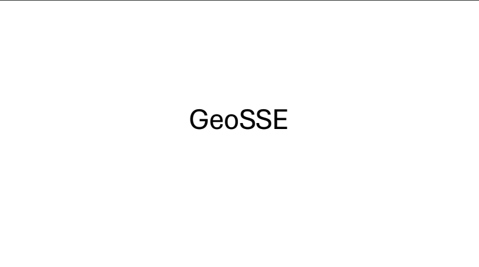
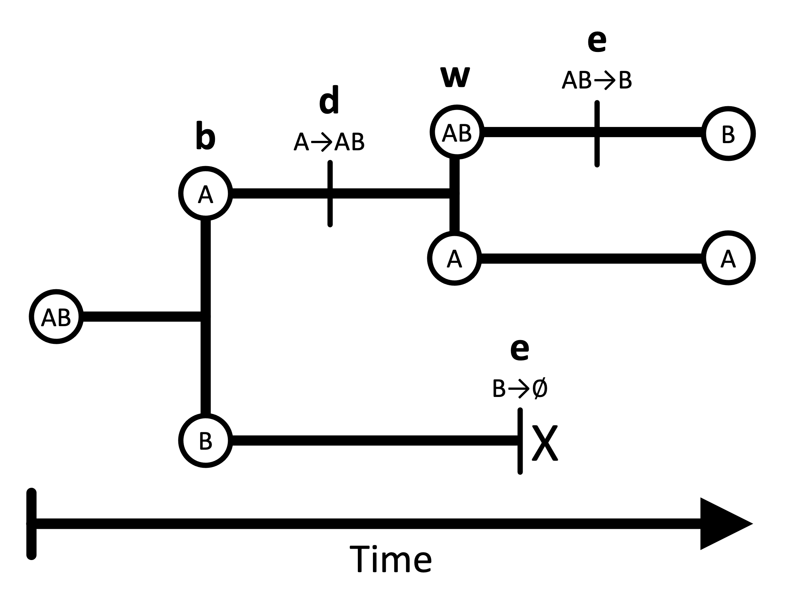
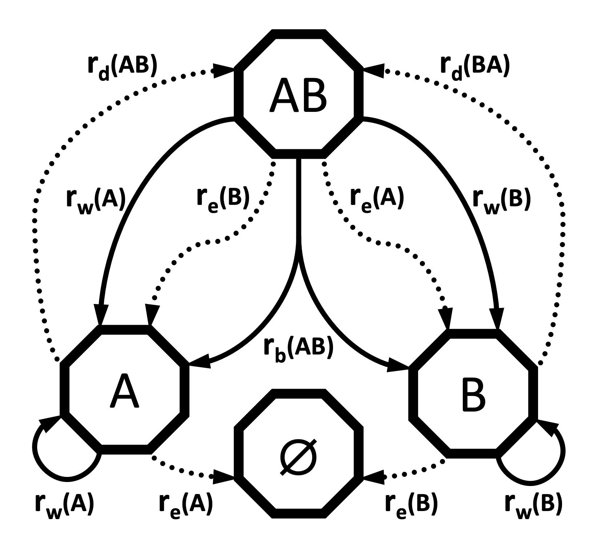

[{fig-align="center" width="500"}](../docs/u2_PatBio/geosse/geoSSE.pdf)

Haz clic en la imagen para ver el PDF de la presentación

## **Introducción**

El modelo **GeoSSE** (*Geographic State Speciation and Extinction*) es un modelo filogenético diseñado para estudiar cambios biogeográficos a lo largo del tiempo evolutivo ([Goldberg et al. 2011](https://academic.oup.com/sysbio/article/60/4/451/1611105?login=true)). Este modelo permite explorar cómo las tasas de diversificación (especiación y extinción) y de dispersión varían entre diferentes regiones geográficas.

En GeoSSE, el "estado" de un linaje representa su rango geográfico, el cual puede estar compuesto por una o más regiones discretas. Por ejemplo, en un escenario con dos regiones (A y B), hay tres rangos geográficos posibles: **A**, **B**, y **AB**.

Los linajes pueden dividirse y cambiar de estado a lo largo del tiempo evolutivo mediante cuatro procesos fundamentales:

1. **Especiación entre regiones (b).-** Este evento ocurre cuando una especie con un rango amplio (por ejemplo, **AB**) se divide en dos especies, cada una ocupando una sola de las regiones. Por ejemplo, el ancestro con rango **AB** se divide en especies hijas con rangos **A** y **B**. Este proceso es **simétrico**: la separación entre **A y B** es equivalente a la separación entre **B y A**.

2. **Dispersión entre regiones (d).-** La dispersión permite que una especie expanda su rango geográfico hacia una nueva región. La tasa de expansión es la **suma** de las tasas de dispersión entre cada par de regiones. Por ejemplo, una especie con rango **A** que se dispersa hacia **B** terminará con rango **AB**.

3. **Especiación dentro de una región (w).-** Este evento genera dos linajes hijos, donde uno hereda **todo** el rango ancestral (que puede ser una o más regiones), y el otro hereda **una sola** región del rango ancestral. Por ejemplo, si la especie ancestral tenía el rango **AB**, una hija podría conservar **AB**, mientras que la otra tendría **A**.

4. **Extinción local** (*extirpación*) **(e).-** La extinción hace que una especie pierda una región de su rango geográfico. Por ejemplo, una especie con rango **AB** puede extinguirse en la región **A**, quedando con rango **B**.

{fig-align="center" width="450"}

- La **especiación dentro de una región** y la **especiación entre regiones** son procesos cladogenéticos que generan nuevos linajes filogenéticos. Estos eventos pueden resultar en especies hijas que ocupan rangos diferentes al de la especie ancestral.

- La **extinción** y la **dispersión**, en cambio, son procesos anagenéticos que ocurren a lo largo de las ramas del árbol filogenético. La extinción y la especiación dentro de regiones ocurren en una sola región, mientras que la dispersión y la especiación entre regiones involucran dos o más regiones.

⚠️ **Nota:** El modelo estándar de GeoSSE **no permite** otros tipos de eventos evolutivos. Por ejemplo, **no se permite** que una especie ancestral con un rango amplio produzca dos hijas que **ambas conserven el rango completo**. Además, GeoSSE solo permite que ocurra **un único evento** por instante de tiempo.

### Diagrama de transición

{fig-align="center" width="350"}

El diagrama de transición del modelo GeoSSE para **dos regiones** resume los cuatro procesos fundamentales:

- Procesos **anagenéticos**: extirpación y dispersión, representados con **flechas punteadas**.
- Procesos **cladogenéticos**: especiación dentro de regiones y especiación entre regiones, representados con **flechas continuas**.

Este diagrama permite visualizar primero **qué puede ocurrir con un linaje**. A continuación veremos cómo se parametrizan esas posibilidades en RevBayes.

## Parámetros del modelo GeoSSE

El modelo **GeoSSE** considera cuatro familias de **tasas elementales**:

- `rw`: especiación **dentro de una región**.
- `re`: extinción local o **extirpación**.
- `rb`: especiación **entre regiones**.
- `rd`: **dispersión** entre regiones.

Aquí hablamos únicamente de **cómo se organizan las tasas elementales por región o por pares de regiones**. Más adelante, RevBayes utilizará estas tasas para construir estructuras de nivel superior como `Q_bg`, `clado_map`, `lambda` y `omega`.

En este ejemplo tenemos **dos regiones geográficas**:

```text
Regiones
A          B
```

pero tres posibles **estados de distribución** para un linaje:

```text
A        B        AB
10       01       11
```

Es importante distinguir ambos niveles:

- **A y B son regiones geográficas.**
- **A, B y AB son estados de distribución de los linajes.**

### Especiación dentro de una región: `rw`

La tasa `rw` está asociada a **una región individual**.

Para dos regiones tenemos:

```text
rw(A)
rw(B)
```

Por ejemplo:

```text
        A
        │
        ●
       / \
      A   A

      rw(A)
```

y:

```text
        B
        │
        ●
       / \
      B   B

      rw(B)
```

Si el ancestro ocupa ambas regiones, una especiación dentro de una región también puede producir:

```text
        AB
        │
        ●
       / \
      A   AB
```

o:

```text
        AB
        │
        ●
       / \
      B   AB
```

Como necesitamos **una tasa por región**, `rw` se organiza como un vector:

$$
r_w=
\begin{pmatrix}
r_w(A)\\
r_w(B)
\end{pmatrix}.
$$

### Extinción local o extirpación: `re`

La tasa `re` también está asociada a **una región individual**, porque representa la pérdida de esa región del rango de una especie.

```text
AB  ── pérdida de A ──>  B
              re(A)

AB  ── pérdida de B ──>  A
              re(B)
```

Si la especie ocupa una sola región, perderla implica la extinción completa del linaje:

```text
A  ── re(A) ──>  extinción
B  ── re(B) ──>  extinción
```

Por ello `re` también se organiza como un vector:

$$
r_e=
\begin{pmatrix}
r_e(A)\\
r_e(B)
\end{pmatrix}.
$$

### Especiación entre regiones: `rb`

La especiación entre regiones involucra **un par de regiones**:

```text
        AB
        │
        ●
       / \
      A   B

      rb(A,B)
```

En este caso no existe una dirección: separar A de B representa el mismo evento que separar B de A. Por ello:

$$
r_b(A,B)=r_b(B,A).
$$

`rb` se organiza como una **matriz simétrica entre regiones**:

$$
r_b=
\begin{pmatrix}
0 & b_{AB}\\
b_{AB} & 0
\end{pmatrix}.
$$

### Dispersión entre regiones: `rd`

La dispersión también involucra dos regiones, pero ahora existe una dirección:

```text
A  ────────>  AB
     d(A,B)
```

frente a:

```text
B  ────────>  AB
     d(B,A)
```

Las dos direcciones pueden tener tasas distintas:

$$
r_d(A,B)\neq r_d(B,A).
$$

Por ello `rd` se organiza como una **matriz dirigida entre regiones**:

$$
r_d=
\begin{pmatrix}
0 & d_{AB}\\
d_{BA} & 0
\end{pmatrix}.
$$

### Resumen de las tasas elementales

| Proceso | Ejemplo | Depende de | Organización elemental |
|:--|:--|:--|:--|
| Especiación dentro de región (`rw`) | `A → A + A` | una región | vector por región |
| Extirpación (`re`) | `AB → B` por pérdida de A | una región | vector por región |
| Especiación entre regiones (`rb`) | `AB → A + B` | par de regiones sin dirección | matriz simétrica entre regiones |
| Dispersión (`rd`) | `A → AB` por dispersión A→B | origen y destino | matriz dirigida entre regiones |

En forma esquemática:

```text
UNA REGIÓN
    │
    ├── rw
    └── re

DOS REGIONES
    │
    ├── rb   par A-B, sin dirección
    └── rd   A→B o B→A, con dirección
```

::: {.callout-note}
## Tasas elementales ≠ estructuras finales del modelo

La clasificación anterior describe solamente cómo están organizadas `rw`, `re`, `rb` y `rd`.

Después, RevBayes transforma y combina esas tasas:

```text
TASAS ELEMENTALES
       │
       ├── re  +  rd
       │        │
       │        ▼
       │       Q_bg
       │   matriz de transición
       │   entre estados A, B y AB
       │
       └── rw  +  rb
                │
                ▼
            clado_map
        mapa de eventos de
           especiación
                │
                ├── lambda
                │   vector de tasas
                │   totales por estado
                │
                └── omega
                    probabilidades de
                    resultados cladogenéticos
```

Por lo tanto, que `re` sea un vector y `rd` una matriz **no significa** que el componente anagenético completo sea un vector o una matriz del mismo tipo. Ambos se combinan para construir `Q_bg`, que opera sobre los **estados de distribución** A, B y AB.

De manera análoga, `rw` y `rb` alimentan `clado_map`, del cual se derivan posteriormente `lambda` y `omega`.
:::

## GeoSSE como modelo SSE

El modelo GeoSSE forma parte de una clase más amplia de modelos conocidos como **modelos SSE (State-dependent Speciation and Extinction)**. Estos modelos permiten que el **estado de un carácter discreto** influya en las tasas de especiación, extinción y transición entre estados.

Otros ejemplos importantes incluyen:

- [**BiSSE**](https://ib-unisse.github.io/patrones_filogeneticos/chapters/u1_intro_diversification_4.html)
- [**ClaSSE**](https://revbayes.github.io/tutorials/sse/classe.html)

GeoSSE es un caso especial de ClaSSE, **estructurado y parametrizado para escenarios biogeográficos**.

## Aplicación del modelo GeoSSE en RevBayes

En esta práctica utilizaremos como ejemplo al género **Kadua**, distribuido en las islas de Hawái, considerando dos regiones:

- **Islas antiguas**
- **Islas jóvenes**

La práctica se realizará en un **servidor GNU/Linux**. Durante la clase se proporcionarán el usuario, contraseña y dirección del servidor.

## Acceso al servidor

Desde una terminal:

```bash
ssh usuario@servidor
```

Los archivos de datos y el script de la práctica se encuentran en:

```bash
/srv/scratch_sda/GeoSSE/shared
```

Podemos revisarlos con:

```bash
ls /srv/scratch_sda/GeoSSE/shared
```

Deberás observar al menos:

```text
geosse.Rev
kadua_range_n2.nex
kadua.tre
```

## Imagen de RevBayes + TensorPhylo

Para esta práctica utilizaremos una imagen de **Apptainer/SIF** preparada específicamente con:

- **RevBayes 1.4.1**
- **TensorPhylo**
- arquitectura `x86_64`
- soporte para **AVX2**
- compilación compatible con procesadores tipo **Intel Haswell/Broadwell o posteriores**

La imagen utilizada en esta práctica fue publicada en Docker Hub:

[**ccervantess/revbayes:1.4.1-tensorphylo-avx2**](https://hub.docker.com/r/ccervantess/revbayes)

Para esta práctica **no es necesario descargar la imagen**, porque ya se encuentra disponible en el servidor en:

```text
/srv/scratch_sda/GeoSSE/shared/rb_tp_1.4.1.sif
```

Por lo tanto, todos los usuarios ejecutarán directamente la misma imagen compartida.

Si se desea utilizar la imagen en otro servidor o computadora con **Apptainer**, puede descargarse desde Docker Hub con:

```bash
apptainer pull \
  rb_1.4.1_tensorphylo_avx2.sif \
  oras://docker.io/ccervantess/revbayes:1.4.1-tensorphylo-avx2
```

Podemos comprobar que RevBayes funciona con:

```bash
apptainer exec \
  /srv/scratch_sda/GeoSSE/shared/rb_tp_1.4.1.sif \
  rb --version
```

La salida deberá indicar:

```text
RevBayes version (1.4.1)
```

La estructura general del comando es:

```text
apptainer exec IMAGEN.sif PROGRAMA ARGUMENTOS
```

### Comprobar TensorPhylo

Podemos iniciar RevBayes de manera interactiva utilizando directamente la imagen compartida:

```bash
apptainer exec \
  /srv/scratch_sda/GeoSSE/shared/rb_tp_1.4.1.sif \
  rb
```

Dentro de RevBayes cargamos el plugin:

```r
loadPlugin("TensorPhylo", "/.plugins")
```

TensorPhylo está instalado dentro de la imagen como:

```text
/.plugins/libTensorPhylo.so
```

Si el plugin carga correctamente, RevBayes regresará al prompt `>`.

Podemos comprobar que una de las funciones proporcionadas por TensorPhylo está disponible:

```r
help("dnGLHBDSP")
```

Para salir de RevBayes:

```r
q()
```

## Datos de entrada

Para ejecutar el análisis necesitamos únicamente dos archivos de datos:

- `kadua.tre`: árbol filogenético calibrado.
- `kadua_range_n2.nex`: matriz de presencia/ausencia por región.

### Árbol filogenético

Podemos revisar el árbol con:

```bash
head /srv/scratch_sda/GeoSSE/shared/kadua.tre
```

Está escrito en formato **Newick** y contiene las relaciones filogenéticas y longitudes de rama.

### Matriz biogeográfica

Podemos revisar la matriz con:

```bash
cat /srv/scratch_sda/GeoSSE/shared/kadua_range_n2.nex
```

Cada fila corresponde a una especie y cada columna a una región.

Para dos regiones:

| Rango | Vector | Interpretación |
|---|---|---|
| A | `10` | presente solo en A |
| B | `01` | presente solo en B |
| AB | `11` | presente en ambas |

El rango vacío `00` no se considera, por lo que con dos regiones tenemos:

\[
2^2 - 1 = 3
\]

rangos posibles.

## Preparar el directorio de trabajo

Primero crearemos una carpeta de trabajo en nuestro `home`:

```bash
mkdir -p ~/GeoSSE/data
mkdir -p ~/GeoSSE/output
```

Ahora copiamos los dos archivos de entrada:

```bash
cp /srv/scratch_sda/GeoSSE/shared/kadua.tre ~/GeoSSE/data/
cp /srv/scratch_sda/GeoSSE/shared/kadua_range_n2.nex ~/GeoSSE/data/
```

También podemos copiar el script completo para ejecutarlo al final:

```bash
cp /srv/scratch_sda/GeoSSE/shared/geosse.Rev ~/GeoSSE/
```

Entramos al directorio:

```bash
cd ~/GeoSSE
```

La estructura será:

```text
GeoSSE/
├── data/
│   ├── kadua.tre
│   └── kadua_range_n2.nex
├── output/
└── geosse.Rev
```

# GeoSSE en RevBayes

## Cargar TensorPhylo

```r
loadPlugin("TensorPhylo", "/.plugins")
```

## Definir las rutas

```r
# FILESYSTEM

fp          = "./"
dat_fp      = fp + "data/"
out_fp      = fp + "output/"

bg_fn       = dat_fp + "kadua_range_n2.nex"
phy_fn      = dat_fp + "kadua.tre"
lbl_fn      = out_fp + "kadua_range_label.txt"
```

`bg_fn` y `phy_fn` son los archivos de entrada.

`lbl_fn` será un **archivo de salida** generado por el propio análisis.

## Leer la filogenia

```r
# PHYLOGENETIC DATA

phy         <- readTrees(phy_fn)[1]
tree_height <- phy.rootAge()
taxa        = phy.taxa()
num_taxa    = taxa.size()
```

- `phy`: árbol filogenético.
- `tree_height`: edad de la raíz.
- `taxa`: nombres de los taxones.
- `num_taxa`: número de taxones.

## Leer los datos biogeográficos

```r
# BIOGEOGRAPHIC DATA

bg_01 = readDiscreteCharacterData(bg_fn)
bg_01.show()
```

Los datos originales están codificados como presencia/ausencia por región.

```r
num_regions = bg_01.nchar()
num_ranges  = abs(2^num_regions - 1)
num_pairs   = num_regions^2 - num_regions
```

Con dos regiones:

```text
num_regions = 2
num_ranges  = 3
num_pairs   = 2
```

Ahora transformamos la matriz binaria al formato requerido por GeoSSE:

```r
bg_dat = formatDiscreteCharacterData(
    bg_01,
    format="GeoSSE",
    numStates=num_ranges
)
```

### Cómo se parametrizan las tasas en RevBayes

En el código, cada familia de tasas se construye en dos pasos:

1. `rho_x` define la **escala general** del proceso.
2. `m_x` distribuye esa escala entre regiones o pares de regiones.

El producto genera las tasas utilizadas por el modelo:

$$
r_x = \rho_x m_x.
$$

Por ejemplo, si `rho_w = 0.2` y `m_w = [1.4, 0.6]`, entonces:

```text
r_w = [0.28, 0.12]
```

::: {.callout-important}
## Dos significados diferentes de `rho`

`rho_w`, `rho_e`, `rho_b` y `rho_d` son parámetros de **tasas evolutivas**.

En cambio, el argumento `rho=1` de `dnGLHBDSP(...)` representa la **fracción de muestreo taxonómico**. En esta práctica, `rho=1` supone muestreo completo.
:::

Los valores mostrados inmediatamente después de definir una variable con `~` son valores iniciales de la cadena, no estimaciones posteriores.

## Especiación dentro de regiones

```r
# WITHIN-REGION SPECIATION

rho_w ~ dnExp(1)

m_w_simplex ~ dnDirichlet(rep(1, num_regions))

m_w := m_w_simplex * num_regions
r_w := rho_w * m_w
```

Aquí `rho_w` define la escala general de la especiación dentro de regiones y `m_w` reparte esa escala entre A y B. El resultado `r_w` contiene una tasa para cada región.


## Extinción

```r
# EXTINCTION

rho_e ~ dnExp(1)

m_e_simplex ~ dnDirichlet(rep(1, num_regions))

m_e := m_e_simplex * num_regions
r_e := rho_e * m_e
```

Ahora definimos la tasa de extinción completa del linaje para cada rango:

```r
for (i in 1:num_ranges) {

    mu[i] <- 0.0

    if (i <= num_regions) {
        mu[i] := r_e[i]
    }
}
```

Aquí conviene distinguir dos niveles:

- `r_e` describe la **pérdida de una región**.
- `mu` contiene la tasa de **extinción completa del linaje** para cada estado.

Por eso, para un rango amplio como AB, `mu=0`: perder solo A o solo B no elimina al linaje, sino que produce una transición de rango que será representada en `Q_bg`.


## Especiación entre regiones

```r
# BETWEEN-REGION SPECIATION

rho_b ~ dnExp(1)

m_b_simplex ~ dnDirichlet(rep(1, num_pairs/2))

m_b_idx = 1

for (i in 1:num_regions) {

    m_b[i][i] <- 0.0

    for (j in 1:num_regions) {

        if (i < j) {

            m_b[i][j] := abs(
                m_b_simplex[m_b_idx] * num_pairs
            )

            m_b[j][i] := abs(
                m_b_simplex[m_b_idx] * num_pairs
            )

            m_b_idx += 1
        }

        r_b[i][j] := rho_b * m_b[i][j]
    }
}
```

La especiación entre regiones es **simétrica**:

\[
b_{A,B}=b_{B,A}
\]

### Índice para los pares de regiones

`m_b_simplex` contiene un peso por **par no ordenado** de regiones. Con dos regiones solo existe el par A-B, por lo que tiene una sola componente.

El condicional `if (i < j)` evita contar dos veces el mismo par y asigna el mismo valor a:

```text
m_b[A][B]
m_b[B][A]
```

`m_b_idx` es únicamente un contador para recorrer esos pesos; **no es un parámetro estimado por la MCMC**.

## Dispersión

```r
# DISPERSAL

rho_d ~ dnExp(1)

m_d_simplex ~ dnDirichlet(rep(1, num_pairs))

m_d_idx = 1

for (i in 1:num_regions) {

    m_d[i][i] <- 0.0

    for (j in 1:num_regions) {

        if (i != j) {

            m_d[i][j] := abs(
                m_d_simplex[m_d_idx++] * num_pairs
            )
        }

        r_d[i][j] := rho_d * m_d[i][j]
    }
}
```

A diferencia de la especiación entre regiones, la dispersión puede ser **asimétrica**:

\[
d_{A,B} \neq d_{B,A}
\]

En dispersión se recorren **pares dirigidos**: A → B y B → A. Por eso `m_d_simplex` contiene un peso para cada dirección. `m_d_idx++` usa el elemento actual y después avanza al siguiente.


### De las tasas elementales a las estructuras del modelo

Hasta aquí hemos definido tasas por **región** o por **pares de regiones**. A partir de este punto, RevBayes las combina para trabajar directamente con los estados de distribución `A`, `B` y `AB`.

## `Q_bg`: matriz de transición anagenética

```r
# ANAGENETIC RATE MATRIX

Q_bg := fnBiogeographyRateMatrix(
    dispersalRates=r_d,
    extirpationRates=r_e,
    maxRangeSize=num_regions
)
```

`Q_bg` combina `r_d` y `r_e` en una matriz de transición **entre estados de distribución**. En nuestro ejemplo, esos estados son A, B y AB. Por tanto, `Q_bg` ya no está organizada simplemente por regiones A y B, sino por los tres estados posibles del rango.

Podemos revisar cómo RevBayes representa los rangos:

```r
Q_bg.getStateDescriptions()[1]
Q_bg.getStateDescriptions()[2]
Q_bg.getStateDescriptions()[3]
```

Para dos regiones esperamos:

```text
10
01
11
```

Por ejemplo, `Q_bg` permite transiciones como A → AB por dispersión o AB → A por extirpación en B. Los eventos de los nodos se especifican por separado mediante `clado_map`.


## `clado_map`: eventos cladogenéticos

```r
# CLADOGENETIC RATE MATRIX

clado_map := fnBiogeographyCladoEventsBD(
    speciation_rates=[rho_w,rho_b],
    within_region_features=m_w,
    between_region_features=m_b,
    max_range_size=num_regions,
    max_subrange_split_size=num_regions
)
```

`clado_map` combina la información de `rw` y `rb` para enumerar los **resultados de especiación permitidos** para cada estado ancestral. Conceptualmente, cada evento depende de un estado ancestral y de los estados de sus dos descendientes.

De aquí obtenemos:

```r
lambda := clado_map.getSpeciationRateSumPerState()
omega  := clado_map.getCladogeneticProbabilityMatrix()
```

- `lambda`: tasa total de especiación para cada estado ancestral.
- `omega`: probabilidades relativas de los distintos resultados cladogenéticos, **dado que ocurre una especiación**.

### Interpretación de `clado_map`, `lambda` y `omega`

La función `fnBiogeographyCladoEventsBD(...)` **construye un mapa de eventos de especiación permitidos y sus tasas**, no una lista de eventos históricos que ya hayan ocurrido. Sus argumentos cumplen funciones distintas:

| Argumento | ¿Qué controla? |
|:--|:--|
| `speciation_rates=[rho_w,rho_b]` | Escalas base de especiación dentro de regiones y entre regiones |
| `within_region_features=m_w` | Heterogeneidad de especiación dentro de regiones |
| `between_region_features=m_b` | Heterogeneidad de separación entre pares de regiones |
| `max_range_size=num_regions` | Tamaño máximo del rango ancestral representado |
| `max_subrange_split_size=num_regions` | Tamaño máximo de subrangos descendientes admitidos por la función |


## Frecuencias iniciales

```r
# PI

pi_base <- rep(1, num_ranges)
pi <- simplex(pi_base)
```

Con esto asignamos la misma probabilidad inicial a todos los rangos posibles.

## Definir el proceso GeoSSE

```r
# TREE

timetree ~ dnGLHBDSP(
    rootAge     = tree_height,
    lambda      = lambda,
    mu          = mu,
    eta         = Q_bg,
    omega       = omega,
    pi          = pi,
    rho         = 1,
    condition   = "time",
    taxa        = taxa,
    nStates     = num_ranges,
    nProc       = 4
)
```

Ahora fijamos el modelo a nuestros datos observados:

```r
timetree.clamp(phy)
timetree.clampCharData(bg_dat)
```

### Relación entre parámetros, filogenia y muestreo

El análisis combina: **`Q_bg`**, que describe cambios anagenéticos de rango; **`lambda`**, que define las tasas totales de especiación; **`omega`**, que define cómo se distribuyen los resultados cladogenéticos; y **`mu`**, que participa en la extinción completa de linajes. `timetree.clamp(phy)` fija la filogenia observada, mientras `timetree.clampCharData(bg_dat)` fija los rangos observados en las puntas.

En el argumento `rho=1` de `dnGLHBDSP` sí hablamos de una **fracción de muestreo taxonómico de 100 %** bajo el supuesto del ejercicio; no debe confundirse con las variables `rho_w`, `rho_e`, `rho_b` y `rho_d` de tasas base.


## Configuración de la MCMC

```r
# MCMC SETUP

n_gen    = 1000
n_burn   = 100
printgen = 10
```

> **Nota:** Esta MCMC es corta y se utiliza únicamente con fines de práctica.

## Movimientos de la MCMC

```r
# MCMC MOVES

mv = VectorMoves()
mvi = 1

mv[mvi++] = mvScale(rho_w, weight=1)
mv[mvi++] = mvScale(rho_e, weight=1)
mv[mvi++] = mvScale(rho_b, weight=1)
mv[mvi++] = mvScale(rho_d, weight=1)

mv[mvi++] = mvSimplex(m_e_simplex, weight=m_e.size())
mv[mvi++] = mvSimplex(m_w_simplex, weight=m_w.size())
# Con dos regiones, m_b_simplex tiene una sola componente [1],
# por lo que no presenta grados de libertad para proponer cambios.
if (m_b_simplex.size() > 1) {
    mv[mvi++] = mvSimplex(m_b_simplex, weight=m_b_simplex.size())
}
mv[mvi++] = mvSimplex(m_d_simplex, weight=m_d_simplex.size())
```

La expresión:

```r
mv[mvi++]
```

usa el valor actual de `mvi` como índice y después aumenta `mvi` en uno.


## Monitores

```r
# MCMC MONITORS

mn = VectorMonitors()
mni = 1

mn[mni++] = mnScreen(
    printgen=printgen
)

mn[mni++] = mnModel(
    printgen=printgen,
    filename=out_fp + "model.log"
)

mn[mni++] = mnJointConditionalAncestralState(
    glhbdsp=timetree,
    tree=timetree,
    printgen=printgen,
    withTips=true,
    withStartStates=true,
    type="NaturalNumbers",
    filename=out_fp + "states.log"
)

mn[mni++] = mnStochasticCharacterMap(
    glhbdsp=timetree,
    printgen=printgen,
    filename=out_fp + "stoch.log"
)
```

De manera análoga:

```r
mn[mni++]
```

usa el índice actual de `mni` y luego lo incrementa.


## Guardar las etiquetas de los estados

```r
# STATE LABELS

write(
    "index,range\n",
    file=lbl_fn
)

state_labels = Q_bg.getStateDescriptions()

for (i in 1:state_labels.size()) {

    write(
        (i-1),
        ",",
        state_labels[i],
        "\n",
        file=lbl_fn,
        append=true,
        separator=""
    )
}
```

Este bloque genera automáticamente:

```text
output/kadua_range_label.txt
```

con una estructura como:

```text
index,range
0,10
1,01
2,11
```

Por lo tanto, este archivo **no es un dato de entrada**.

## Ejecutar la MCMC

```r
# MCMC START

mdl = model(m_w)

ch = mcmc(
    mv,
    mn,
    mdl
)

ch.burnin(
    n_burn,
    tuningInterval=50
)

ch.run(n_gen)
```

## Reconstrucción de estados ancestrales

```r
# ANCESTRAL STATES

f_burn = 0.2

x_stoch = readAncestralStateTrace(
    file=out_fp + "stoch.log"
)

x_states = readAncestralStateTrace(
    file=out_fp + "states.log"
)
```

Resumimos los mapas de caracteres:

```r
summarizeCharacterMaps(
    x_stoch,
    timetree,
    file=out_fp + "events.tsv",
    burnin=f_burn
)
```

Y generamos el árbol con la reconstrucción ancestral:

```r
state_tree = ancestralStateTree(
    tree=timetree,
    ancestral_state_trace_vector=x_states,
    include_start_states=true,
    file=out_fp + "ase.tre",
    summary_statistic="MAP",
    reconstruction="marginal",
    burnin=f_burn,
    nStates=num_ranges,
    site=1
)

writeNexus(
    state_tree,
    filename=out_fp + "ase.tre"
)

print("DONE")
q()
```

## Ejecutar el script completo

Desde `~/GeoSSE`:

```bash
apptainer exec \
  /srv/scratch_sda/GeoSSE/shared/rb_tp_1.4.1.sif \
  rb geosse.Rev
```

Al terminar podemos revisar:

```bash
ls -lh output/
```

Deberán aparecer archivos como:

```text
model.log
states.log
stoch.log
events.tsv
ase.tre
kadua_range_label.txt
```

## Descargar los resultados a nuestra computadora

Los resultados permanecen en el servidor dentro de:

```text
~/GeoSSE/output/
```

Para descargarlos utilizaremos `scp`.

> **Importante:** este comando debe ejecutarse desde una terminal de **nuestra computadora**, no desde la sesión SSH del servidor.

Para descargar todo el directorio:

```bash
scp -r usuario@servidor:~/GeoSSE/output ./GeoSSE_output
```

La estructura general es:

```text
scp -r origen destino
```

Para descargar un solo archivo, por ejemplo:

```bash
scp usuario@servidor:~/GeoSSE/output/ase.tre .
```

El punto `.` significa **el directorio actual de nuestra computadora**.

## Graficar los estados ancestrales en R

Una vez descargado `ase.tre`, podemos visualizarlo con **RevGadgets**.

```{r, results='hide'}
library(RevGadgets)
library(ggplot2)

tree_file <- "../docs/u2_PatBio/geosse/out/ase.tre"

states <- processAncStates(
  tree_file,
  state_labels = c(
    "0" = "Islas antiguas",
    "1" = "Islas jóvenes",
    "2" = "Ambas regiones"
  )
)

plotAncStatesMAP(
  t = states,
  node_size = 2,
  node_size_as = NULL
) +
  ggplot2::theme(
    legend.position = "bottom",
    legend.title = element_blank()
  )
```
