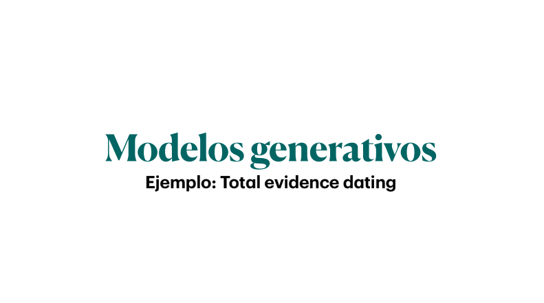
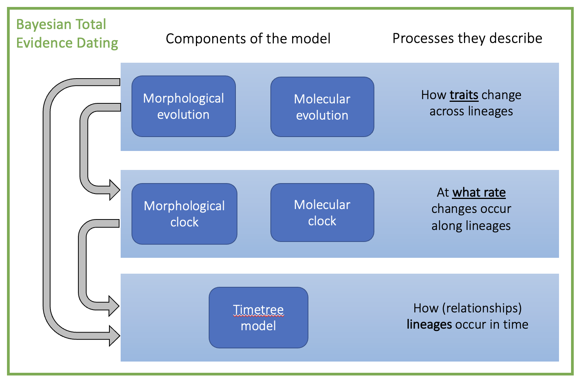
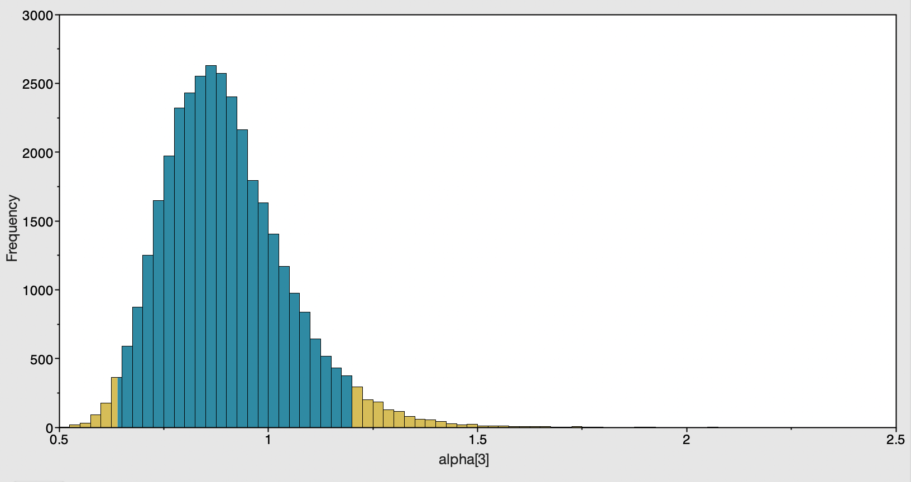
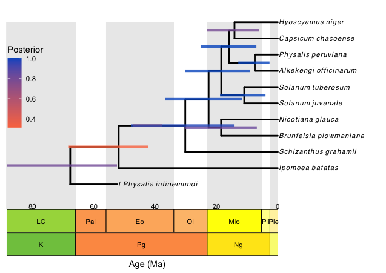

# Presentación: Modelos generativos, ejemplo: total evidence dating

[{fig-align="center" width="500"}](../docs/u3_PatMorph/paleobotany/modelos_generativos.pdf)

Haz clic en la imagen para ver el PDF de la presentación

## Introducción

Un análisis bayesiano de **datación por evidencia total** (TED) infiere simultáneamente **la topología** y **los tiempos de divergencia** de un conjunto de terminales. Este enfoque presenta varias ventajas. En primer lugar, no requiere que coloquemos los fósiles en un clado específico, *como se exige en la datación por nodos*; en su lugar, los especímenes fósiles se ubican en la filogenia a partir de su propia información **morfológica** y **temporal**. Como resultado, obtenemos probabilidades posteriores de las posiciones de los fósiles, en vez de tener que asumir su posición filogenética. En segundo lugar, este enfoque permite incluir **más de un fósil** que presumiblemente pertenezca a un grupo, mientras que en la datación por nodos normalmente seleccionamos únicamente el fósil más antiguo para calibrar un nodo de interés. Al incluir todos los fósiles disponibles para un grupo, podemos obtener una visión más completa de él.

Aunque los análisis bayesianos TED son interesantes y prometedores, también son complejos. A medida que analizamos más datos empíricos con este modelo, comenzamos a comprender mejor la interacción entre sus distintos componentes. También se ha vuelto evidente la importancia de comprender las implicaciones de nuestras decisiones de modelado. Este tutorial fue escrito por una investigadora empírica interesada en los métodos TED, por lo que está concebido como una guía práctica para realizar un análisis TED, más que como una guía teórica. Su objetivo es servir como una **introducción al modelo bayesiano de datación por evidencia total** mediante el programa RevBayes. Me centraré en explicar los **diferentes componentes** del modelo, destacando cómo **expresamos nuestras creencias previas** sobre nuestro sistema de estudio y cómo estos componentes y distribuciones a priori se traducen en scripts del lenguaje de RevBayes. Otro objetivo igualmente importante para mí es facilitar una introducción al «*lenguaje*» de los análisis bayesianos TED y a la estructura de RevBayes. A lo largo del tutorial señalaré distintas referencias y otros tutoriales en los que podrás profundizar en temas que aquí trataremos solo de manera superficial. El código de este tutorial puede adaptarse fácilmente para realizar un análisis de evidencia total con tus propios datos. Si buscas un tutorial más avanzado sobre análisis bayesianos TED, que incluya código para comparar distintos modelos y evaluar su adecuación, visita [esta página](https://revbayes.github.io/tutorials/ted_workflow/). Finalmente, cuando hayas completado este taller introductorio, te invito a consultar las grabaciones más extensas de las clases de nuestro [taller de estimación de tiempos de divergencia](https://mikeryanmay.github.io/ted.workshop.github.io/).

#### Una mirada al modelo bayesiano de datación por evidencia total

**El tipo de datos**.

Antes de entrar en los detalles del modelo, conviene mencionar qué tipo de datos se necesitan para utilizar el modelo bayesiano TED. Cuando el grupo de estudio incluye terminales actuales y extintos, el conjunto de datos suele incluir **tanto caracteres moleculares como morfológicos**. Sin embargo, también puede realizarse un análisis TED utilizando únicamente caracteres morfológicos. Esto resulta especialmente plausible cuando todos los terminales son fósiles. No existe una restricción sobre el número de fósiles utilizados, aunque una de las recomendaciones es contar con fósiles distribuidos ampliamente en el tiempo y entre linajes.

**El modelo bayesiano TED**

Un modelo bayesiano de datación por evidencia total puede entenderse como un conjunto de componentes que son, a su vez, modelos de procesos específicos (Fig. 1). Todos estos componentes se integran en un análisis TED general, en el que potencialmente pueden informarse entre sí mediante sus interacciones. Como se observa en la figura 1, tenemos **modelos de evolución de caracteres**, que describen cómo cambian los caracteres (morfológicos o moleculares) entre linajes. Tenemos **modelos de reloj**, que describen la tasa a la que ocurren los cambios (morfológicos o moleculares) a lo largo de los linajes. Y también tenemos un **modelo de árbol temporal (timetree)**, que describe cómo cambian los linajes (aparecen y desaparecen) a través del tiempo. ¡Veamos un ejemplo y revisemos cada uno de los cinco componentes de un análisis bayesiano TED!



**Fig. 1.** Modelo bayesiano de datación por evidencia total. Este modelo tiene cinco componentes principales, cada uno de los cuales modela procesos específicos.

------------------------------------------------------------------------

## El tutorial: un ejemplo con la familia del tomate

### Los archivos

En este tutorial desarrollaremos un ejemplo de análisis de datación por evidencia total utilizando un conjunto de datos muy reducido de especies actuales y extintas de la familia del tomate: Solanaceae. Puedes descargar todos los archivos de datos y scripts de este tutorial [desde este repositorio](https://github.com/ixchelgzlzr/evolution_workshop.git). En este tutorial trabajaremos con un conjunto de 12 terminales, de los cuales dos son fósiles. Los datos moleculares corresponden a los alineamientos de tres marcadores moleculares: *ITS*, *TrnLF* y *waxy*. La matriz morfológica contiene 16 caracteres.

### Descarga de materiales para la práctica

Los archivos siguientes se pueden descargar directamente desde esta página. Para ejecutar el análisis completo, **descarga el paquete ZIP**, descomprímelo y conserva su estructura de carpetas (`data/`, `scripts/` y `output/`). Los nombres y rutas coinciden con los que utiliza el código del tutorial.

<a href="../docs/u3_PatMorph/paleobotany/tutorial_evolution_2022.zip" download>📦 **Descargar paquete completo de datos y scripts de RevBayes (.zip)**</a>

**Datos individuales**

| Archivo | Descarga |
|------------------------------------|------------------------------------|
| Lista de taxones y edades (`taxa.tsv`) | <a href="../docs/u3_PatMorph/paleobotany/tutorial_evolution_2022/data/taxa.tsv" download>Descargar archivo</a> |
| Matriz morfológica (`morphology.nexus`) | <a href="../docs/u3_PatMorph/paleobotany/tutorial_evolution_2022/data/morphology.nexus" download>Descargar archivo</a> |
| Alineamiento ITS (`ITS_aligned.fasta`) | <a href="../docs/u3_PatMorph/paleobotany/tutorial_evolution_2022/data/alignments/ITS_aligned.fasta" download>Descargar archivo</a> |
| Alineamiento trnLF (`trnLF_aligned.fasta`) | <a href="../docs/u3_PatMorph/paleobotany/tutorial_evolution_2022/data/alignments/trnLF_aligned.fasta" download>Descargar archivo</a> |
| Alineamiento waxy (`waxy_aligned.fasta`) | <a href="../docs/u3_PatMorph/paleobotany/tutorial_evolution_2022/data/alignments/waxy_aligned.fasta" download>Descargar archivo</a> |

**Scripts individuales de RevBayes**

| Script | Descarga |
|------------------------------------|------------------------------------|
| Script principal (`TED_tutorial_evolution.Rev`) | <a href="../docs/u3_PatMorph/paleobotany/tutorial_evolution_2022/scripts/TED_tutorial_evolution.Rev" download>Descargar archivo</a> |
| Modelo FBD (`time_tree_model.Rev`) | <a href="../docs/u3_PatMorph/paleobotany/tutorial_evolution_2022/scripts/time_tree_model.Rev" download>Descargar archivo</a> |
| Modelo de evolución molecular (`mol_evol_model.Rev`) | <a href="../docs/u3_PatMorph/paleobotany/tutorial_evolution_2022/scripts/mol_evol_model.Rev" download>Descargar archivo</a> |
| Reloj molecular (`mol_clock_model.Rev`) | <a href="../docs/u3_PatMorph/paleobotany/tutorial_evolution_2022/scripts/mol_clock_model.Rev" download>Descargar archivo</a> |
| Modelo de evolución morfológica (`morph_evol_model.Rev`) | <a href="../docs/u3_PatMorph/paleobotany/tutorial_evolution_2022/scripts/morph_evol_model.Rev" download>Descargar archivo</a> |
| Reloj morfológico (`morph_clock_model.Rev`) | <a href="../docs/u3_PatMorph/paleobotany/tutorial_evolution_2022/scripts/morph_clock_model.Rev" download>Descargar archivo</a> |

### Organización de los directorios

Los archivos proporcionados con este tutorial tienen una estructura específica que facilita la claridad y la organización. Para evitar problemas, **no modifiques la estructura proporcionada**. La carpeta principal se llama `tutorial_evolution_2022`. Todos los scripts están preparados para ejecutarse desde este directorio principal. Puedes ejecutar el análisis completo abriendo tu terminal en la carpeta `tutorial_evolution_2022` y ejecutando el siguiente comando:

``` r
rb scripts/TED_tutorial_evolution.Rev
```

Sin embargo, el objetivo del tutorial es explicar algunos detalles del código y cómo refleja nuestras decisiones de modelado y distribuciones a priori. Por eso vale la pena tomarse el tiempo necesario y ejecutar el análisis paso a paso.

El directorio principal contiene tres subdirectorios: `data`, `scripts` y `output`. La carpeta `data` contiene los alineamientos moleculares, los datos morfológicos y la lista de terminales con información sobre la edad de todos ellos, representada en dos columnas: la edad estratigráfica máxima y la mínima. Puedes explorar la estructura de cada archivo abriéndolo con tu editor de texto. La carpeta `scripts` contiene todo nuestro código y la carpeta `output` es donde se almacenarán todos los archivos de resultados.

------------------------------------------------------------------------

## El script principal

Como mencionamos, un análisis bayesiano TED es modular: existen componentes naturales —que constituyen modelos por sí mismos— que se integran en un modelo más grande y complejo. La organización de los scripts refleja esa modularidad. Existe un script principal, `TED_tutorial_evolution.Rev`, que reúne los distintos componentes llamándolos mediante la función `source()`:

``` r
# example, don't run this code
# I am running another script called "my_other_script.Rev"
source("my_other_script.Rev")
```

Comencemos con el script principal. Abre el script **TED_tutorial_evolution.Rev** en tu editor de texto. Puedes seguir el tutorial copiando y pegando los fragmentos de código en tu terminal. Asegúrate de ejecutar el código desde la carpeta `tutorial_evolution_2022`.

### Lectura y preparación de los datos

Comenzaremos leyendo todos los datos: las secuencias, los datos morfológicos y los datos de los taxones. También obtendremos información útil, como el número de alineamientos, el número de taxones, el número de ramas del árbol y el número de fósiles en el conjunto de datos.

``` r
# read the sequence data
    # get the name of our files
markers <- v(
  "data/alignments/ITS_aligned.fasta",
  "data/alignments/trnLF_aligned.fasta",
  "data/alignments/waxy_aligned.fasta"
  )
    # how many alignmentes do we have
naln <-markers.size()

    #read the alignments
for(i in 1:naln) {
    moledata[i] = readDiscreteCharacterData(markers[i]) 
}

# read the morphological data
morphdata = readDiscreteCharacterData("data/morphology.nexus")

# read the taxon data
taxa    = readTaxonData("data/taxa.tsv", delimiter=TAB)
ntax    = taxa.size()   # number of taxa
nbranch = 2 * ntax - 2  # number of branches in rooted phylogeny

# count the number of fossils using a for loop
num_fossils = 0

for(i in 1:taxa.size()) {
  if (taxa[i].getMinAge() != 0) {
    num_fossils = num_fossils + 1
  }
}
```

Cuando utilizamos más de un marcador molecular, como en este ejemplo, es frecuente que algunos terminales no estén representados en todos los alineamientos; sin embargo, RevBayes requiere que todos los alineamientos contengan los mismos taxones. El siguiente *bucle for* garantiza que todos los terminales estén presentes en todos los alineamientos.

``` r
# the alignments do not have the total number of taxa,
# we need to manually add missing taxa to the sequence data:
for(i in 1:naln) {
  x = moledata[i]
  x.addMissingTaxa(taxa)
  moledata[i] = x
}
```

A continuación, prepararemos los datos morfológicos. A diferencia de los datos moleculares, que tienen **única y siempre** cuatro estados posibles de carácter (A, C, G, T), los caracteres morfológicos pueden tener un **número diferente de estados**. Más adelante utilizaremos un modelo Mk para la evolución morfológica, que requiere particionar los datos morfológicos según su número de estados. Lo haremos con un bucle for que recorre los posibles números de estados y conserva únicamente los caracteres que presentan un número dado de estados.

``` r
# First, we add missing taxa to the morphological data
morphdata.addMissingTaxa(taxa)

# partition morphological data by number of states
  # the maximum number of states in my dataset
n_max_states = 10  # consider changing this for your own data, if necessary

  # start a counter
idx = 0

  # for each number of character states
for (i in 2:n_max_states) {

    # make a tempory character alignment
    morph_tmp <- morphdata

    # retain characters with i states
    morph_tmp.setNumStatesPartition(i)

    # if there are more than zero characters with this many states...
    # store the data partition
    if ( morph_tmp.nchar() > 0 ) {
        morph_partitions[++idx] = morph_tmp
        nc[idx] = i
    }
}


# compute the number of morphological partitions
num_morph_parts = morph_partitions.size()
```

¡Ahora nuestros datos están preparados!

### Algunas particularidades de RevBayes

Una parte importante de la escritura de código en RevBayes consiste en especificar los **movimientos (moves)** que utilizará la cadena de Markov Monte Carlo (MCMC) para **proponer cambios** en los valores de los parámetros que estamos estimando. Siempre especificamos al menos un movimiento por parámetro y, en ocasiones, podemos utilizar movimientos que operan sobre más de un parámetro a la vez (por ejemplo, aumentando el valor de uno y disminuyendo el de otro). Normalmente especificamos los movimientos justo después de definir la distribución a priori del parámetro. Mantendremos un registro de todos los movimientos que utilizaremos en nuestro análisis almacenándolos en un solo contenedor: **un vector de movimientos**:

``` r
# create empty vector of moves
# we will fill it as we specify moves
moves = VectorMoves()
```

A medida que la MCMC explora el espacio de parámetros, registra los valores de los parámetros que estamos estimando mediante **monitores (monitors)** (funciones que normalmente guardan variables en un archivo). De manera similar al contenedor de movimientos, necesitamos un contenedor para los monitores:

``` r
# monitors vector
monitors = VectorMonitors()
```

El siguiente fragmento de código almacenará en memoria el número $H$, que posee algunas propiedades matemáticas interesantes, como $\pi$.

``` r
# convenient constants
H = ln(10) / (qnorm(0.975) - qnorm(0.025))
```

¡Ya estamos listos para comenzar a especificar nuestro modelo! Si quieres saber más sobre los movimientos, puedes seguir el tutorial [Introducción a MCMC utilizando RevBayes](https://revbayes.github.io/tutorials/mcmc/binomial.html).

## 1) El modelo de árbol temporal

El primer componente del modelo es el modelo de árbol. En el script principal lo llamamos mediante:

``` r
source("scripts/time_tree_model.Rev")
```

Para consultar el script, ve a `tutorial_evolution_2022/scripts/time_tree_model.Rev`. Utilizaremos un árbol basado en un **proceso de nacimiento y muerte fosilizado (Fossilized Birth-Death Process)** (comúnmente llamado **árbol FBD**). En pocas palabras, el proceso de nacimiento y muerte fosilizado más sencillo tiene tres parámetros:

-   la **tasa de nacimiento** $\lambda$ (= especiación cladogenética).

-   la **tasa de muerte** $\mu$ (= extinción).

-   la **tasa de fosilización** $\psi$.

La decisión de utilizar un proceso FBD como base de nuestro árbol temporal implica que consideramos que es una buena representación de cómo evoluciona un linaje a través del tiempo.

***Notas para reflexionar*****:** ¿Qué opinas? ¿Es un modelo satisfactorio?

En el tutorial de hoy utilizaremos un proceso FBD de **tasa constante**, en el que la especiación, la extinción y la fosilización son constantes a través del tiempo y entre linajes. Sin embargo, este modelo puede extenderse para incorporar variación en las tasas. Si te interesa conocer más sobre el proceso FBD, te recomiendo consultar [este](https://revbayes.github.io/tutorials/fbd/fbd_specimen.html) tutorial y [este](https://revbayes.github.io/tutorials/ted_workflow/) otro tutorial.

Comencemos especificando algunos datos particulares de nuestro conjunto. Primero, dado que no hemos muestreado todos los taxones actuales, especificaremos un parámetro de fracción de muestreo, **rho**:

``` r
# # First we specify some dataset-specific parameters
extant_taxa = 9                 # total number of extant taxa in the tree
total_taxa  = 2800              # total number of extant taxa in the group
rho <- extant_taxa/total_taxa   # sampling fraction
```

### 1.1. El tiempo de origen

El modelo de árbol temporal requiere especificar un parámetro para el momento en que comienza el proceso FBD. En este caso, especificaremos un tiempo de origen para el linaje troncal que dio lugar a nuestro grupo focal (Solanaceae) y a nuestro grupo externo (Convolvulaceae, representado en nuestros datos por *Ipomoea batatas*). Especificaremos la edad de ese clado a partir del trabajo de [Magallón et al. (2015)](https://nph.onlinelibrary.wiley.com/doi/10.1111/nph.13264), quienes infirieron una edad del grupo corona de Solanaceae con un intervalo HPD del 95 % entre 85.91 y 100.4 millones de años (Ma). Sin otra información disponible, utilizaremos una distribución a priori uniforme para `origin_time`, que abarque ese intervalo de edades. También agregaremos un movimiento para este parámetro.

``` r
origin_min = 85.91
origin_max = 100.34
origin_time ~ dnUniform(origin_min, origin_max)    # Prior
moves.append( mvSlide( origin_time, weight = 5) )  # Moves
```

***Notas para reflexionar*****:** ¿Se te ocurre otra manera de especificar el punto de inicio del proceso FBD? ¿Utilizarías otra fuente de información?

### 1.2. Tasas constantes de especiación y extinción

Como mencionamos, utilizaremos el modelo de árbol FBD más sencillo, uno en el que las tasas no varían a través del tiempo ni entre linajes. Comenzaremos especificando una **distribución a priori empírica** (es decir, informada por nuestros datos) para la tasa de diversificación, de modo que, en promedio, dé lugar al número total de taxones que observamos actualmente en Solanaceae. La desviación estándar de esta distribución es $H$, lo que implica que la verdadera tasa de diversificación se encuentra dentro de un orden de magnitud de la media a priori.

``` r
# empirical prior on the diversification rate
diversification_prior_mean <- ln(total_taxa) / origin_time
diversification_prior_sd   <- H

# the diversification rate
diversification ~ dnLognormal( ln(diversification_prior_mean) - diversification_prior_sd * diversification_prior_sd * 0.5, diversification_prior_sd)
# moves on the diversification rate
moves.append( mvScale(diversification, weight = 1.0) )
```

Obtendremos la **tasa relativa de extinción** de una distribución a priori uniforme que va de 0 a 1. La tasa de extinción no puede ser negativa. Y si fuese mayor que 1, probablemente no tendríamos ningún linaje en el presente. Después agregamos un movimiento para la tasa relativa de extinción.

``` r
# the relative extinction rate
relext ~ dnUniform(0, 1)
moves.append( mvSlide(relext, weight = 1.0) )
```

En este ejemplo optamos por parametrizar nuestro modelo comenzando con distribuciones a priori para la tasa de diversificación y la tasa relativa de extinción, porque es más fácil especificar una distribución a priori para la diversificación que para la especiación. Después transformamos las tasas de diversificación y de extinción relativa en tasas de **especiación** y **extinción**.

``` r
# transform to speciation and extinction
lambda := abs(diversification / (1 - relext))
mu     := abs(lambda * relext)
```

***Notas para reflexionar*****:** ¿Qué tipos de acontecimientos evolutivos podríamos incorporar si permitimos que estas tasas varíen? ¿Son relevantes esos acontecimientos en todos los casos empíricos?

### 1.3. La tasa constante de fosilización

Una vez más, utilizamos un modelo de tasa constante; por lo tanto, suponemos que la tasa de fosilización es constante a través del tiempo y entre linajes. Utilizaremos una distribución a priori empírica centrada en una tasa de fosilización tal que, en promedio, esperemos observar el mismo número de fósiles que en nuestro conjunto de datos empíricos:

``` r
# empirical prior on the fossilization rate
fossilization_prior_mean <- num_fossils * diversification_prior_mean / (exp(diversification_prior_mean * origin_time) - 1)
fossilization_prior_sd   <- 2 * H
```

Después obtenemos la tasa de fosilización $\psi$ de una distribución lognormal y agregamos algunos movimientos para este parámetro:

``` r
# the fossilization rate
psi ~ dnLognormal( ln(fossilization_prior_mean) - fossilization_prior_sd * fossilization_prior_sd * 0.5, fossilization_prior_sd)

# add moves
moves.append( mvScale(psi, weight = 1.0) )
```

Ahora que hemos definido todos los elementos de un árbol FBD (tiempo de inicio y tasas de especiación, extinción y fosilización), podemos crear nuestra distribución de árboles FBD `dnFBDP`, de la que muestrearemos nuestros árboles temporales:

``` r
# make the FBD tree

timetree ~ dnFBDP(
    originAge = origin_time,
    lambda = lambda,
    mu = mu,
    psi = psi,
    condition = "survival",
    taxa = taxa,
    rho = rho
)
```

Como con cualquier parámetro que estemos estimando, debemos configurar algunos movimientos sobre el árbol. De hecho, la topología del árbol es difícil de estimar, así que aplicaremos muchos movimientos sobre ella. Comencemos por la topología y las longitudes de rama:

``` r
# Proposals on the tree topology
moves.append( mvSubtreeScale(timetree, weight=ntax/5.0) )
moves.append( mvFNPR(timetree,                       weight = ntax                      ) )
moves.append( mvNarrow(timetree,                     weight = 5 * ntax                  ) )
moves.append( mvNodeTimeSlideUniform(timetree,       weight = 5 * ntax                  ) )
moves.append( mvSubtreeScale(timetree,               weight = 5 * ntax                  ) )
moves.append( mvRootTimeSlideUniform(timetree,       weight = ntax, origin = origin_time) )
```

Como en este modelo los fósiles pueden ser ancestros muestreados, agregaremos algunos movimientos para este parámetro y mantendremos un registro de él (es decir, almacenaremos esa variable en la memoria de nuestra computadora).

``` r
# MCMC proposals on whether fossils are sampled ancestors
moves.append( mvCollapseExpandFossilBranch(timetree, weight = num_fossils, origin = origin_time) )
# keep track of number of sampled ancestors
num_sampled_ancestors := timetree.numSampledAncestors()
```

A continuación, agregaremos algunos movimientos sobre la edad de los fósiles para incorporar la incertidumbre estratigráfica que expresamos inicialmente en `taxa.tsv`.

``` r
# MCMC proposals on the fossil ages
fossils = timetree.getFossils()
for(i in 1:fossils.size()) {

  # get the fossil age
  t[i] := tmrca(timetree, clade(fossils[i]))

  # specify the age contraint
  a = fossils[i].getMinAge()
  b = fossils[i].getMaxAge()

  F[i] ~ dnUniform(t[i] - b, t[i] - a)
  F[i].clamp( 0 )

  # specify a proposal on the fossil age
  moves.append( mvFossilTimeSlideUniform(timetree, origin_time, fossils[i], weight = 1.0) )

}
```

Y nuestro último movimiento es un movimiento conjunto sobre el árbol y las tasas de rama. Los movimientos conjuntos son útiles cuando tenemos parámetros correlacionados.

``` r
# make a joint proposal for the tree (and later the branch rates)
moves.append( mvUpDownScale(weight=10, tuneTarget=0.234, lambda=0.01) )
tree_scale_move_index = moves.size()
moves[tree_scale_move_index].addVariable(timetree,    up=false)
moves[tree_scale_move_index].addVariable(origin_time, up=false)
```

Finalmente, mantendremos un registro de la longitud del árbol (TL) a lo largo de nuestro análisis, por lo que la agregaremos:

``` r
# keep track of the tree length
TL := timetree.treeLength()
```

¡Hemos terminado de especificar nuestro modelo de árbol temporal!

***Notas para reflexionar*****:** La **tasa de fosilización** es una variable que probablemente recibió un nombre poco adecuado. Muchos paleontólogos sostendrían que sería mejor llamarla **tasa de recuperación de fósiles**. ¿Qué opinas? ¿Tiene esto implicaciones para nuestras decisiones de modelado?

## 2) El modelo de evolución molecular

De vuelta en el script principal, especificaremos nuestro **modelo de evolución molecular** (es decir, **la manera** en la que ocurren los cambios moleculares) con el siguiente fragmento de código:

``` r
source("scripts/mol_evol_model.Rev")
```

Revisemos el código. Ve a `tutorial_evolution_2022/scripts/mol_evol_model.Rev`. Utilizaremos un modelo estándar de evolución molecular **GTR + Gamma**, particionado por marcador. En nuestro modelo especificaremos una **matriz Q** (una matriz de tasas instantáneas) para cada marcador. Las matrices Q contienen la tasa a la que cada nucleótido cambia a otro nucleótido en un instante determinado (es decir, un intervalo de tiempo **muy corto**). Y, como esperamos que distintas posiciones de nuestro alineamiento cambien a tasas diferentes, utilizaremos una **distribución gamma discretizada** para incorporar esta variación.

Como tenemos tres marcadores moleculares y necesitamos una matriz Q (`mole_Q`) y tasas de sitio moleculares (`mole_site_rates`) para cada uno, utilizaremos un bucle for en nuestro código. Observa que también agregaremos algunos movimientos para cada parámetro dentro del bucle.

``` r
# Q matrix per partition
  # for each alignment
for (i in 1:naln) {
  # the stationary frequency
  mole_pi[i] ~ dnDirichlet(rep(1,4))
  moves.append( mvBetaSimplex(mole_pi[i], weight = 1.0) )

  # the exchangeability rates
  mole_kappa[i] ~ dnDirichlet(rep(1,6))
  moves.append( mvBetaSimplex(mole_kappa[i], weight = 1.0))

  # create the Q matrices
  mole_Q[i] := fnGTR(mole_kappa[i], mole_pi[i])

  # the site rates drawn from a gamma distribution
  alpha[i] ~ dnExponential( 1.0 )
  moves.append( mvScale(alpha[i], lambda=0.01, weight=1.0) )
  moves.append( mvScale(alpha[i], lambda=0.1,  weight=1.0) )
  moves.append( mvScale(alpha[i], lambda=1,    weight=1.0) )
  mole_site_rates[i] := fnDiscretizeGamma( alpha[i], alpha[i], 4)
}
```

¡Además, esperamos que las tasas de evolución molecular varíen entre marcadores! Por lo tanto, incorporaremos esta variación creando un multiplicador de tasa (`mole_relative_rates`) que después utilizaremos para escalar la tasa de sustitución entre loci.

``` r
# we allow different markers evolve at different rates
# relative-rate multipliers
mole_proportional_rates ~ dnDirichlet(rep(1, naln))
moves.append( mvBetaSimplex(mole_proportional_rates, weight = naln) )

# rescale the rates so the mean is 1
mole_relative_rates := abs(mole_proportional_rates * naln)
```

No he entrado en muchos detalles sobre el modelo de evolución molecular, pero, si quieres saber más, puedes visitar [este tutorial](https://revbayes.github.io/tutorials/ctmc/) para obtener más información sobre los modelos de evolución molecular o [este tutorial](https://revbayes.github.io/tutorials/partition/) para comprender por qué y cómo particionamos los datos moleculares.

***Notas para reflexionar*****:** Como sucede con todos los componentes del modelo bayesiano TED, puedes elegir entre diferentes modelos y maneras de parametrizarlos. En términos prácticos, los parámetros de evolución molecular de un modelo GTR + G suelen estar entre los más fáciles de estimar dentro de este marco.

## 3) El modelo de reloj molecular: lognormal no correlacionado relajado

De regreso en el script principal, especificaremos nuestro **modelo de reloj molecular** (es decir, la **tasa** a la que ocurren los cambios moleculares por unidad de tiempo) llamando al script correspondiente:

``` r
source("scripts/mol_clock_model.Rev")
```

Revisemos el código del script `scripts/mol_clock_model.Rev`. El **modelo de reloj molecular** describe la tasa a la que las secuencias evolucionan a lo largo de los linajes. En este tutorial utilizaremos un **modelo de reloj lognormal no correlacionado (UCLN)**. Este modelo supone que **cada rama tiene su propia tasa**; que esas tasas no están correlacionadas (a diferencia de los relojes locales, cuyas tasas dependen del clado) y que las tasas proceden de una distribución lognormal.

Comencemos definiendo la distribución lognormal de la que obtendremos las tasas de rama. Para definirla necesitamos dos parámetros: la media (`mole_clock_rate_mean`) y la desviación estándar (`mole_clock_rate_sd`). Agregaremos movimientos para cada uno:

``` r
# draw the clock mean such as its log distribution is uniform
mole_clock_rate_mean ~ dnLoguniform(1e-10, 1e1)
moves.append( mvScale(mole_clock_rate_mean) )
mole_clock_rate_mean.setValue(1e-7)
# draw the standard deviation from an exponential
mole_clock_rate_sd ~ dnExponential(abs(1 / H))
moves.append( mvScale(mole_clock_rate_sd) )
```

Ahora podemos obtener las tasas individuales de las ramas (`mole_branch_rates`) —y agregar algunos movimientos— utilizando un bucle for. Observa que todas las tasas individuales de rama se obtienen de la distribución compartida que especificamos anteriormente:

``` r
# the branch-specific rates
for(i in 1:nbranch) {
  # draw the log of the rate
  mole_branch_rates[i] ~ dnLognormal(
    ln(mole_clock_rate_mean) - mole_clock_rate_sd * mole_clock_rate_sd * 0.5, mole_clock_rate_sd)
  moves.append( mvScale(mole_branch_rates[i]) )
}
```

Calculemos ahora la media de todas las tasas moleculares de las ramas. Mantendremos un registro de este valor en los resultados de nuestro análisis.

``` r
# the mean of the branch rate
mole_branch_rate_mean := mean(mole_branch_rates)
```

¿Recuerdas el movimiento conjunto que empezamos a configurar en el modelo de árbol temporal? Terminemos de configurarlo para que proponga simultáneamente cambios en el árbol (lo que ya hicimos) y en las tasas de rama (lo que estamos haciendo aquí). Este movimiento tiene sentido porque podemos esperar que, dado un cierto número de sustituciones, si aumenta la tasa de sustitución (los cambios ocurren en menos tiempo), el árbol temporal deba ser más joven.

``` r
# add branch rates to joint scale move on tree
moves[tree_scale_move_index].addVariable(mole_branch_rates, up=true)
moves[tree_scale_move_index].addVariable(mole_clock_rate_mean, up=true)
```

***Notas para reflexionar*****:** Los modelos de reloj son un componente muy importante de cualquier análisis de datación: infieren el número esperado de cambios de carácter por unidad de tiempo, lo que nos permite convertir las longitudes de rama expresadas en el número esperado de cambios (procedentes del modelo de evolución molecular) al tiempo que observamos en el árbol temporal. Los parámetros del modelo de reloj (las tasas de rama) son muy sensibles a nuestras distribuciones a priori y suelen ser difíciles de estimar. Puedes aprender más sobre los relojes moleculares [en este tutorial](https://revbayes.github.io/tutorials/clocks/).

### La CTMC para los datos moleculares

Hasta este punto del tutorial, hemos especificado por completo nuestro modelo molecular. Es decir, hemos establecido las distribuciones a priori y las relaciones entre todos los parámetros que describen cómo evolucionan las secuencias moleculares en el árbol temporal.

Ahora utilizaremos la función `dnPhyloCTMC()` para crear una distribución de alineamientos que depende de los parámetros de nuestro modelo TED (el **árbol temporal** `timetree`; nuestros parámetros de evolución molecular `mole_Q`, `mole_site_rates` y `mole_relative_rates`; y nuestro parámetro del reloj molecular `mole_branch_rates`). Esta distribución define la probabilidad de los datos (los alineamientos) dados los valores de los parámetros, lo que en ocasiones se denomina función de verosimilitud (likelihood). Para asignar nuestro alineamiento observado a esta distribución, utilizamos `.clamp(data)`.

Como puedes ver a continuación, lo hacemos para cada marcador mediante un bucle for:

``` r
# make the CTMC for molecular data
for(i in 1:naln) {
  seq[i] ~ dnPhyloCTMC(timetree, mole_Q[i], branchRates = mole_branch_rates, siteRates = mole_site_rates[i] * mole_relative_rates[i])
  seq[i].clamp( moledata[i] )
}
```

## 4) El modelo de evolución morfológica

Ahora cambiemos de tema y pensemos en nuestro **modelo de evolución morfológica**. Tal como hicimos con los datos moleculares, especificaremos un modelo que describa **cómo ocurren los cambios morfológicos** en nuestros linajes.

Vale la pena detenernos un momento para hablar de que los caracteres morfológicos son más difíciles de modelar porque no se pueden generalizar fácilmente. Por ejemplo, a diferencia de los caracteres moleculares, distintos caracteres morfológicos pueden presentar números diferentes de estados, y no está claro cuál es el mejor esquema de partición. Modelar con precisión la evolución de los caracteres morfológicos requiere experiencia en el grupo de estudio y en el modelado estadístico. Lo cierto es que la evolución morfológica es un campo de investigación activo y prometedor. Si quieres conocer más sobre este tema, puedes comenzar con [este tutorial](https://revbayes.github.io/tutorials/morph_tree/).

Volviendo al script principal, ejecutaremos nuestro **modelo Mk de evolución morfológica** llamando al script:

``` r
source("scripts/morph_evol_model.Rev")
```

Puedes revisar el código de este componente del modelo bayesiano TED principal en `scripts/morph_evol_model.Rev`.

Hoy utilizaremos el **modelo Mk** para nuestros caracteres morfológicos. Este modelo describe el cambio de un estado de carácter a otro mediante una matriz (similar a la matriz Q), de modo que necesitamos una matriz de 2 × 2 para modelar la evolución de un carácter con dos estados; una matriz de 3 × 3 para modelar la evolución de un carácter con tres estados, y así sucesivamente. Esa es la razón práctica por la que necesitábamos particionar nuestra matriz morfológica según el número de estados de carácter.

Independientemente del número de estados, el modelo Mk supone que todos los cambios entre los estados de carácter ocurren a la **misma tasa**. Es una extensión del modelo JC de evolución de caracteres, razón por la cual utilizamos la función `fnJC`. Una vez más, observa que lo hacemos dentro de un bucle for, de modo que tenemos una `morph_Q` por cada partición de datos morfológicos.

``` r
# for each morphological partition
for (i in 1:num_morph_parts) {
    morph_Q[i] <- fnJC(nc[i])
}
```

No esperamos que diferentes caracteres evolucionen a la misma tasa. Relajaremos este supuesto del modelo Mk agregando un multiplicador de tasa extraído de una distribución gamma discretizada. Esto es análogo al modelo **+ Gamma** de evolución molecular.

``` r
# Specifying the gamma parameter
  # number of categories
num_rate_cats_morph = 4         
  # prior
morph_site_rate_alpha ~ dnUniform(0, 10)
  # moves
moves.append( mvScale(morph_site_rate_alpha) )
  # site rates
morph_site_rates := fnDiscretizeGamma(morph_site_rate_alpha, morph_site_rate_alpha, num_rate_cats_morph)
```

***Notas para reflexionar*****:** ¿Qué otras particularidades tienen los conjuntos de datos morfológicos? Tal vez algunas relacionadas con la manera en que nosotros, los biólogos, recopilamos los datos. ¡Así es! ¡Tendemos a enfocarnos únicamente en los caracteres que varían entre los terminales! Te invito a leer sobre este **sesgo de ascertainment (sesgo de selección de caracteres)** [aquí](https://revbayes.github.io/tutorials/morph_tree/#sec_ascertainment_bias).

## 5) El modelo de reloj morfológico

De vuelta en el script principal, especificaremos nuestro **modelo de reloj morfológico** llamando al siguiente script:

``` r
source("scripts/morph_clock_model.Rev")
```

En ese script describiremos **la tasa** a la que evolucionan los caracteres morfológicos a lo largo de los linajes.

Supondremos que la tasa media de evolución morfológica se obtiene de una distribución a priori loguniforme. Por lo tanto, estableceremos la distribución a priori y agregaremos algunos movimientos de la siguiente manera:

``` r
# draw the log of the rate from a uniform distribution
morph_clock_rate_log ~ dnUniform(-10, 1)
moves.append( mvSlide(morph_clock_rate_log) )
morph_clock_rate_log.setValue(-7)

# exponentiate
morph_clock_rate := exp(morph_clock_rate_log)
```

En este tutorial supondremos que el reloj morfológico y el reloj molecular están **correlacionados**. Es decir, supondremos que un linaje cuyas secuencias evolucionan más rápido también tiene una morfología que evoluciona más rápido en comparación con otros linajes. Parametrizaremos esto definiendo las tasas morfológicas individuales de rama (`morph_branch_rates`) como una función de las tasas moleculares de rama (`mole_branch_rates`), escaladas por la tasa media de evolución morfológica relativa a la tasa media de evolución molecular.

``` r
# the branch-specific morphological rates
morph_branch_rates := morph_clock_rate/mole_branch_rate_mean * mole_branch_rates 
```

***Notas para reflexionar*****:** ¿Crees que las tasas de cambio molecular y morfológico están correlacionadas? ¿Cómo lo pondrías a prueba?

### La CTMC para los datos morfológicos

Como hicimos con la parte molecular del modelo, ahora debemos especificar nuestra CTMC para incorporar los datos morfológicos a nuestro modelo. De vuelta en el script principal, utilizaremos un bucle for para hacerlo con cada partición:

``` r
# Make the CTMC for morphological data

for (i in 1:morph_Q.size()){
  morph[i] ~ dnPhyloCTMC(timetree, morph_Q[i], branchRates = morph_branch_rates, siteRates = morph_site_rates, coding  = "variable", type = "Standard")
  morph[i].clamp ( morph_partitions[i] )
}
```

Observa que esta vez agregamos el argumento `coding = "variable"` para incorporar el hecho de que analizamos únicamente caracteres variables, y `type = "Standard"` para indicar a RevBayes que se trata de datos morfológicos categóricos y no de ADN.

## Ejecución del análisis

Lo último que tenemos que hacer es almacenar nuestro modelo completamente especificado, junto con los datos asociados, en un objeto llamado `my_model`.

``` r
my_model = model(timetree)
```

Ahora que hemos **especificado por completo** nuestro **modelo bayesiano TED** (¡bien!), estamos listos para ejecutar el análisis. El código siguiente ***indica a RevBayes*** cómo ejecutar nuestra MCMC. Por ejemplo, durante cuánto tiempo (es decir, cuántas generaciones), con qué frecuencia y dónde guardar los resultados, y si debe mostrar información en la pantalla de nuestra computadora mientras se ejecuta el análisis.

Antes de comenzar a definir estos parámetros, vale la pena mencionar que puedes consultar [este tutorial](https://revbayes.github.io/tutorials/mcmc/binomial.html) si necesitas repasar qué es una MCMC y cómo funciona.

Desde una perspectiva empírica, debes recordar que una **MCMC** (Markov chain Monte Carlo) utiliza un algoritmo (el algoritmo de Metropolis-Hastings) para **proponer cambios** (¡sí, aquí es donde entran en juego todos esos movimientos que configuraste!) en los parámetros de un modelo. El **algoritmo de Metropolis-Hastings** está diseñado para que los cambios propuestos se **acepten siempre** cuando aumentan la **probabilidad posterior** del parámetro y, en ocasiones, también cuando no la aumentan. Pero lo más importante es que la MCMC *visita* los valores de los parámetros **de manera proporcional a su probabilidad posterior (PP)**. Por lo tanto, los valores con una PP más alta se visitarán **con mayor frecuencia**. Así, cuando visualizamos la densidad de los valores visitados por la MCMC (por ejemplo, en Tracer), podemos obtener una estimación del valor del parámetro y del error asociado.



**Fig. 2.** Densidad marginal de un parámetro.

Comencemos especificando dónde queremos almacenar los resultados del análisis. Los archivos se guardarán en un directorio llamado `output/run_1`. Tener una carpeta adicional (`run_1`) resulta especialmente útil cuando realizas varias ejecuciones de un mismo análisis. Por ejemplo, tal vez estés probando versiones ligeramente diferentes de un análisis que después quieres comparar.

``` r
# specifying the output directory
output_dir      = "output"
output_extra    = "run_1" # change the name as you wish
output_filename = output_dir + "/" + output_extra + "/"
```

Por lo general, la MCMC se ejecutará durante miles de generaciones. Podemos decidir si queremos almacenar o no cada valor de parámetro que visite la MCMC. Aquí guardaremos los valores cada 10 generaciones:

``` r
# print generation every 10 iteration
printgen <- 10
```

También necesitamos configurar los monitores (es decir, aquello de lo que la computadora mantendrá un registro). En principio, la MCMC puede ejecutarse sin almacenar **ninguno** de los estados que visita. Tenemos que indicarle que muestre los estados en la pantalla de nuestra computadora:

``` r
monitors.append( mnScreen(printgen = printgen) )
```

En un archivo:

``` r
monitors.append( mnModel(filename  = output_filename + "params.log", printgen = printgen, exclude = ["F"]) )
```

Y también queremos un archivo separado para los árboles:

``` r
monitors.append( mnFile(filename   = output_filename + "tree.trees", printgen = printgen, timetree) )
```

A continuación, indicaremos a la MCMC cuántas generaciones ejecutará. Una generación corresponde aproximadamente a realizar cada propuesta un número de veces proporcional a su peso. En este ejemplo ejecutaremos la MCMC durante 20 000 generaciones.

``` r
ITERATIONS = 20000
```

RevBayes ofrece la opción de ejecutar una cadena de **burn-in**. Esta cadena optimiza los movimientos sobre los parámetros para conseguir una mezcla adecuada.

``` r
BURNIN     = 1000
```

A continuación, almacenamos toda la información de nuestro análisis MCMC en un objeto llamado `my_mcmc`. Observa que los argumentos son el modelo, los monitores y los movimientos.

``` r
my_mcmc = mcmc(my_model, monitors, moves)
```

Primero ejecutamos nuestra cadena de burn-in:

``` r
my_mcmc.burnin(BURNIN, tuningInterval=5)
```

¡Y ahora ejecutamos nuestra MCMC (¡bien!):

``` r
my_mcmc.run(ITERATIONS)
```

En este punto, el análisis comenzará a ejecutarse y a mostrar en pantalla los valores de nuestros parámetros cada 10 generaciones. Si iniciaste el análisis al comienzo del tutorial ejecutando el script principal, puede que ya haya terminado. Si no, ten paciencia. Puede tardar un poco.

### Generación de árboles resumen

El último fragmento de código de nuestro script principal genera árboles resumen. Una vez que haya terminado la MCMC, leeremos el archivo que contiene los árboles. Observa que especificamos que estos árboles son árboles temporales con el argumento `"clock"`.

``` r
# Making a summary tree:
  # Read trace
full_trees = readTreeTrace(output_filename + "tree.trees", "clock")
```

Después calculamos el **árbol de máxima credibilidad de clados (MCC, Maximum Clade Credibility)**. Se trata de un árbol de consenso que contiene los clados con el mayor soporte en nuestra muestra posterior de árboles (sí, ¡en nuestros 2 000 árboles muestreados!).

``` r
  # Get the Maximum credibility tree (MCC)
mccTree(full_trees, output_filename + "MCC_tree.tre", conditionalAges = TRUE)
```

Tal vez también queramos observar el **árbol de máxima probabilidad a posteriori (MAP, Maximum a Posteriori)**: el árbol de la muestra que tiene la probabilidad posterior más alta. No es un árbol de consenso, sino uno de los árboles de nuestra muestra.

``` r
  # get the Maximum a posteriori tree (MAP)
mapTree(full_trees, output_filename + "MAP_tree.tre")
```

Ahora puedes visualizar tus árboles en FigTree y tus resultados en Tracer. En la carpeta scripts también encontrarás un script de R que utiliza el paquete [RevGadgets](https://revbayes.github.io/tutorials/intro/revgadgets.html) para generar una gráfica como la siguiente:



Fig. 3. Árbol MCC resultante del análisis de este tutorial.

**Nota importante:** Recuerda que, antes de hacer inferencias a partir de los árboles obtenidos en tu análisis, debes asegurarte de que la **MCMC haya convergido**. Si no sabes con certeza qué significa esto, consulta [este tutorial](https://revbayes.github.io/tutorials/convergence/). Además, incluso si tu MCMC ha convergido, eso solo significa que tus resultados son precisos dado tu modelo y tus distribuciones a priori, no que tu modelo sea preciso. Para evaluar esto, necesitas comparar modelos y analizar su adecuación. ¡Esta observación no pretende desanimarte a aplicar este tipo de modelos a tus datos! Al contrario, pretende animarte a seguir explorando estos métodos en [tutoriales más avanzados](https://revbayes.github.io/tutorials/ted_workflow/), donde aprenderás a comparar modelos y evaluar su adecuación a tus datos.

------------------------------------------------------------------------

***Notas finales para reflexionar*****:** La respuesta a muchas de las preguntas anteriores sobre qué modelo es mejor depende de nuestros datos. La manera de abordar estas preguntas es mediante la **comparación de modelos** (para responder *cuál de los modelos competidores es mejor*) y la **adecuación del modelo** (para responder *si los supuestos de nuestro modelo son razonables*).

------------------------------------------------------------------------

**Agradecimientos:** Gracias a **Mike May** y **Carl Rothfels** por su continua tutoría mientras avanzo en el mundo de la filogenética.
